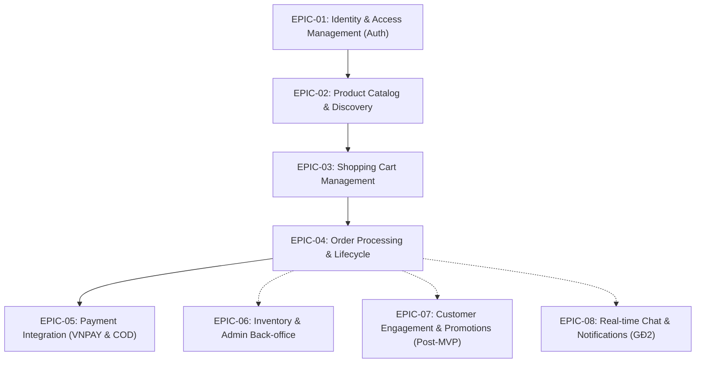
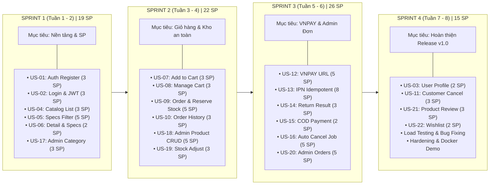
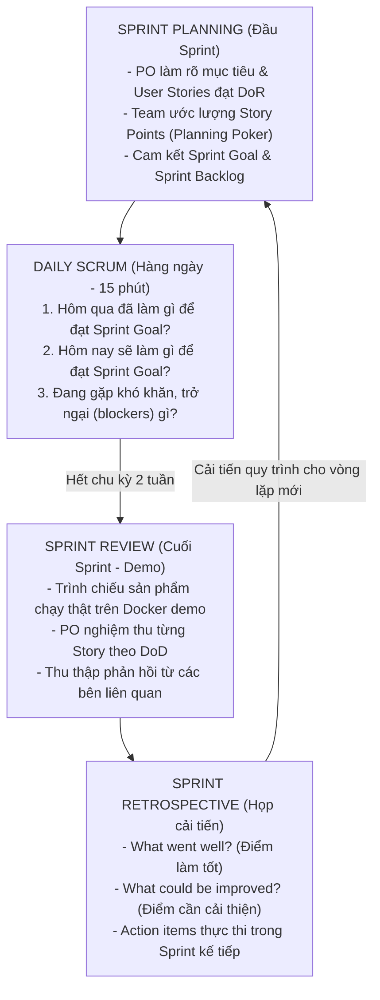

# Shoptila E-Commerce – Tài Liệu Quản Trị Dự Án Theo Mô Hình Agile/Scrum

> **Dự án:** Shoptila – Website thương mại điện tử thiết bị công nghệ  
> **Kiến trúc:** Modular Monolith (Spring Boot 3, React Vite TypeScript, PostgreSQL, VNPAY Sandbox)  
> **Phiên bản tài liệu:** v1.0.0  
> **Người biên soạn:** Chuyên gia Quản lý Phần mềm (Agile Coach / Scrum Master)

---

## Mục lục

1. [Tổng Quan Khung Làm Việc Scrum](#1-tổng-quan-khung-làm-việc-scrum)
2. [Bộ Quy Chuẩn: Definition of Ready (DoR) & Definition of Done (DoD)](#2-bộ-quy-chuẩn-definition-of-ready-dor--definition-of-done-dod)
3. [Phương Pháp Ước Lượng & Phân Cấp Ưu Tiên](#3-phương-pháp-ước-lượng--phân-cấp-ưu-tiên)
   - [Thang đo Story Points (Planning Poker - Fibonacci)](#thang-đo-story-points-planning-poker---fibonacci)
   - [Mô hình MoSCoW](#mô-hình-moscow)
4. [Cấu Trúc Epic Tổng Thể](#4-cấu-trúc-epic-tổng-thể)
5. [Product Backlog Chi Tiết](#5-product-backlog-chi-tiết)
   - [Bảng Tổng Hợp Product Backlog](#bảng-tổng-hợp-product-backlog)
   - [Chi Tiết Từng User Story Kèm Acceptance Criteria (AC)](#chi-tiết-từng-user-story-kèm-acceptance-criteria-ac)
6. [Kế Hoạch Phân Chia Sprint (Sprint Roadmap)](#6-kế-hoạch-phân-chia-sprint-sprint-roadmap)
7. [Quy Trình Vận Hành Scrum Ceremonies](#7-quy-trình-vận-hành-scrum-ceremonies)

---

## 1. Tổng Quan Khung Làm Việc Scrum

Dự án Shoptila áp dụng khung phát triển phần mềm **Scrum** để tối ưu hóa tính linh hoạt, bàn giao sản phẩm sớm và liên tục (Incremental & Iterative Delivery):

- **Độ dài Sprint:** 2 tuần / Sprint.
- **Vai trò chính (Scrum Roles):**
  - **Product Owner (PO):** Quản lý Product Backlog, làm rõ nghiệp vụ, nghiệm thu User Story theo Acceptance Criteria.
  - **Scrum Master (SM):** Điều phối quy trình Agile, gỡ bỏ trở ngại (impediments), tối ưu hóa velocity của team.
  - **Development Team:** 1 Tech Lead / Full-stack, 2 Backend Developers, 2 Frontend Developers, 1 QA/QC Tester.
- **Công cụ theo dõi:** Jira / GitHub Projects, Git Flow / Trunk-based branching.

---

## 2. Bộ Quy Chuẩn: Definition of Ready (DoR) & Definition of Done (DoD)

### 2.1. Definition of Ready (DoR) – Điều kiện để đưa User Story vào Sprint

Một User Story được coi là **Ready** (sẵn sàng đưa vào Sprint Backlog trong buổi Sprint Planning) khi đáp ứng đủ tiêu chí **INVEST**:
- [x] **Independent:** User Story độc lập, giảm thiểu phụ thuộc chéo vào story khác chưa làm.
- [x] **Negotiable:** Có không gian thảo luận giải pháp kỹ thuật giữa Dev và PO.
- [x] **Valuable:** Mang lại giá trị cụ thể cho người dùng cuối hoặc quản trị viên.
- [x] **Estimable:** Đã được Dev Team hiểu rõ nghiệp vụ và ước lượng được Story Points (không vượt quá 13 SP; nếu >= 13 SP phải phân tách nhỏ hơn).
- [x] **Small:** Kích thước vừa phải, hoàn thành trọn vẹn trong vòng 1 Sprint (khuyến nghị 2 - 8 SP).
- [x] **Testable:** Có đầy đủ **Acceptance Criteria (AC)** rõ ràng (theo chuẩn Given - When - Then hoặc checklist cụ thể).
- [x] **UI/UX & API Contract:** Đã có wireframe/mockup (Figma) hoặc thống nhất sơ bộ payload DTO/API.

---

### 2.2. Definition of Done (DoD) – Điều kiện hoàn thành một User Story

Một User Story chỉ được đánh dấu là **Done** khi thỏa mãn toàn bộ checklist sau:
- [x] **Mã nguồn (Source Code):**
  - Code tuân thủ quy ước Clean Code, modular monolith boundaries (chỉ giao tiếp qua `api/` package và events).
  - Không vi phạm các quy tắc bảo mật (không hardcode secret, validate đầu vào ở cả Client & Server).
- [x] **Code Review:** Được ít nhất 1 Peer Reviewer duyệt (Pull Request được Approve).
- [x] **Database Migration:** Mọi thay đổi bảng/cột đều qua Flyway script phiên bản mới, không sửa script cũ.
- [x] **Kiểm thử tự động (Unit & Integration Tests):**
  - Đạt độ phủ Unit Test tối thiểu 70% nghiệp vụ core.
  - Các test đặc thù đã chạy thành công: kiểm tra concurrency trừ tồn kho (`InventoryConcurrencyTest`), chữ ký VNPAY (`VnpaySignatureTest`), tính idempotent của IPN (`IpnIdempotencyTest`).
- [x] **API Documentation:** OpenAPI / Swagger UI được cập nhật đúng DTO, HTTP status, lỗi dạng `ProblemDetail`.
- [x] **Kiểm thử thủ công (Manual Testing & QA):** QA đã verify pass toàn bộ Acceptance Criteria trên môi trường `develop` / `staging`.
- [x] **Triển khai (Deployment):** Build Docker thành công, chạy ổn định trên môi trường demo, không có lỗi console hay crash hệ thống.
- [x] **Product Owner nghiệm thu:** PO trực tiếp demo và nhấn Approve.

---

## 3. Phương Pháp Ước Lượng & Phân Cấp Ưu Tiên

### Thang đo Story Points (Planning Poker - Fibonacci)

Nhóm áp dụng dãy số Fibonacci rút gọn `(1, 2, 3, 5, 8, 13)` đại diện cho độ phức tạp, rủi ro và khối lượng công việc:

| Story Point | Mức độ phức tạp | Tiêu chí tham chiếu | Ví dụ minh họa |
|:---:|:---|:---|:---|
| **1 SP** | Rất thấp (Trivial) | Thay đổi nhỏ UI, fix lỗi text, thêm validation đơn giản, thay đổi cấu hình. | Thêm nút Đăng xuất, validate định dạng số điện thoại. |
| **2 SP** | Thấp (Small) | CRUD cơ bản trên 1 bảng đơn lẻ, form nhập liệu chuẩn, ít logic nghiệp vụ. | Quản lý danh mục (Category CRUD), Xem thông tin tài khoản cá nhân. |
| **3 SP** | Trung bình (Medium) | Nghiệp vụ tiêu chuẩn gồm API backend + UI React + validate dữ liệu đầy đủ. | Đăng ký & Đăng nhập JWT, Giỏ hàng (thêm/sửa số lượng/xóa). |
| **5 SP** | Khá cao (Large) | Nghiệp vụ phức tạp, liên quan đến 2-3 module, xử lý transaction, validate đa lớp. | Bộ lọc sản phẩm đa tiêu chí (RAM, CPU, Brand, Giá) có phân trang & indexing; Đặt hàng lưu snapshot. |
| **8 SP** | Cao (Very Large) | Nghiệp vụ logic cao, tích hợp bên thứ ba, xử lý bất đồng bộ, concurrency hoặc tính toàn vẹn tài chính. | Tích hợp cổng thanh toán VNPAY (Url creation, HMAC-SHA512, Return URL & IPN Webhook Idempotency). |
| **13 SP** | Cực kỳ phức tạp (Epic nhỏ) | Rủi ro cao, kiến trúc mới, quá nhiều phụ thuộc. **Cần phân tách (split) thành các story nhỏ hơn (3, 5, 8)**. | Tách hệ thống sang microservices hoàn chỉnh hoặc viết toàn bộ module Order + Inventory + Payment cùng lúc. |

---

### Mô hình MoSCoW

- **M - Must Have (Bắt buộc phải có):** Các tính năng cốt lõi tạo nên MVP (Minimum Viable Product) để hệ thống hoạt động khép kín: Đăng ký/đăng nhập, xem sản phẩm, giỏ hàng, đặt hàng, trừ tồn kho an toàn, thanh toán VNPAY & COD, quản trị admin cơ bản.
- **S - Should Have (Nên có):** Tính năng quan trọng gia tăng trải nghiệm người dùng, có thể chuyển sang Sprint kế tiếp nếu cạn kiệt thời gian nhưng không được bỏ qua trước khi Go-live chính thức: Hủy đơn hàng trước thanh toán, quản lý địa chỉ nhận hàng, lọc nâng cao theo thông số kỹ thuật.
- **C - Could Have (Có thể có):** Tính năng tiện ích, triển khai khi MVP đã ổn định: Đánh giá & bình luận sản phẩm, danh sách yêu thích (Wishlist), mã giảm giá voucher/coupon.
- **W - Won't Have this time (Chưa làm đợt này / Dành cho Giai đoạn tiếp theo):** Tính năng thuộc lộ trình tương lai (GĐ 2, 3): Chat realtime với CSKH qua WebSocket, thông báo đẩy & email, tách microservices, kiến trúc event-driven Kafka.

---

## 4. Cấu Trúc Epic Tổng Thể

Dự án Shoptila được tổ chức thành **8 Epic** bao quát từ MVP đến mở rộng:

| Mã Epic | Tên Epic | Module Phụ Trách | Mục tiêu kinh doanh |
|:---|:---|:---|:---|
| **EPIC-01** | Quản lý Xác thực & Tài khoản người dùng | `auth`, `common` | Cho phép người dùng đăng ký, đăng nhập bảo mật và quản lý hồ sơ cá nhân. |
| **EPIC-02** | Danh mục & Tìm kiếm sản phẩm | `catalog` | Giúp khách hàng dễ dàng tra cứu, lọc và chọn thiết bị công nghệ phù hợp. |
| **EPIC-03** | Giỏ hàng mua sắm | `cart` | Lưu trữ tạm thời các sản phẩm dự định mua, tính toán tổng tiền chính xác. |
| **EPIC-04** | Đặt hàng & Xử lý đơn hàng | `order`, `inventory` | Quản lý toàn vẹn quy trình tạo đơn, khóa tồn kho và chuyển đổi trạng thái đơn. |
| **EPIC-05** | Tích hợp Cổng thanh toán (VNPAY & COD) | `payment`, `order` | Cung cấp phương thức thanh toán an toàn, xác thực giao dịch qua IPN chuẩn xác. |
| **EPIC-06** | Quản trị Sản phẩm & Kho hàng (Admin Back-office) | `catalog`, `inventory`, `order` | Cung cấp công cụ cho ban quản trị vận hành kho, cập nhật giá và duyệt đơn hàng. |
| **EPIC-07** | Đánh giá, Yêu thích & Khuyến mãi | `review`, `promotion` *(Should/Could)* | Tăng độ uy tín sản phẩm và kích thích doanh số bán hàng. |
| **EPIC-08** | Thông báo & Chat hỗ trợ trực tuyến | `notification`, `chat` *[GĐ2]* | Nâng cao trải nghiệm chăm sóc khách hàng thời gian thực qua WebSocket. |

---

## 5. Product Backlog Chi Tiết

### Bảng Tổng Hợp Product Backlog

| Story ID | Epic | Tên User Story | Vai trò | MoSCoW | Story Points | Sprint |
|:---|:---|:---|:---|:---:|:---:|:---:|
| **US-01** | EPIC-01 | Đăng ký tài khoản khách hàng mới | Khách vãng lai | **Must** | 3 | Sprint 1 |
| **US-02** | EPIC-01 | Đăng nhập hệ thống và phát hành JWT | Khách hàng / Admin | **Must** | 3 | Sprint 1 |
| **US-03** | EPIC-01 | Xem & Cập nhật thông tin cá nhân | Khách hàng | **Should** | 2 | Sprint 4 |
| **US-04** | EPIC-02 | Xem danh sách sản phẩm & Phân trang | Khách hàng | **Must** | 3 | Sprint 1 |
| **US-05** | EPIC-02 | Tìm kiếm & Lọc sản phẩm theo CPU, RAM, Hãng, Giá | Khách hàng | **Must** | 5 | Sprint 1 |
| **US-06** | EPIC-02 | Xem chi tiết thông số kỹ thuật sản phẩm | Khách hàng | **Must** | 2 | Sprint 1 |
| **US-07** | EPIC-03 | Thêm sản phẩm vào giỏ hàng | Khách hàng | **Must** | 3 | Sprint 2 |
| **US-08** | EPIC-03 | Quản lý giỏ hàng (Xem, sửa số lượng, xóa sản phẩm) | Khách hàng | **Must** | 3 | Sprint 2 |
| **US-09** | EPIC-04 | Đặt hàng với thông tin giao hàng & Giữ tồn kho | Khách hàng | **Must** | 5 | Sprint 2 |
| **US-10** | EPIC-04 | Xem lịch sử và chi tiết trạng thái đơn hàng | Khách hàng | **Must** | 3 | Sprint 2 |
| **US-11** | EPIC-04 | Khách hàng hủy đơn hàng chưa thanh toán | Khách hàng | **Should** | 3 | Sprint 4 |
| **US-12** | EPIC-05 | Thanh toán đơn hàng qua VNPAY Sandbox | Khách hàng | **Must** | 5 | Sprint 3 |
| **US-13** | EPIC-05 | Xử lý VNPAY IPN Webhook (Server-to-Server Idempotency) | Hệ thống / VNPAY | **Must** | 8 | Sprint 3 |
| **US-14** | EPIC-05 | Xử lý Return URL & Hiển thị kết quả thanh toán | Khách hàng | **Must** | 3 | Sprint 3 |
| **US-15** | EPIC-05 | Tùy chọn thanh toán khi nhận hàng (COD) | Khách hàng | **Must** | 2 | Sprint 3 |
| **US-16** | EPIC-04 | Job tự động hủy đơn quá hạn thanh toán & Hoàn kho | Hệ thống | **Must** | 5 | Sprint 3 |
| **US-17** | EPIC-06 | Admin quản lý danh mục và thương hiệu | Admin | **Must** | 3 | Sprint 1 |
| **US-18** | EPIC-06 | Admin quản lý sản phẩm (CRUD sản phẩm & cấu hình) | Admin | **Must** | 5 | Sprint 2 |
| **US-19** | EPIC-06 | Admin cập nhật và điều chỉnh tồn kho | Admin | **Must** | 3 | Sprint 2 |
| **US-20** | EPIC-06 | Admin quản lý & Cập nhật trạng thái đơn hàng | Admin | **Must** | 5 | Sprint 3 |
| **US-21** | EPIC-07 | Khách hàng đánh giá & chấm sao sản phẩm đã mua | Khách hàng | **Could** | 3 | Sprint 4 |
| **US-22** | EPIC-07 | Danh sách sản phẩm yêu thích (Wishlist) | Khách hàng | **Could** | 2 | Sprint 4 |
| **US-23** | EPIC-07 | Áp dụng mã giảm giá (Coupon/Voucher) | Khách hàng | **Could** | 5 | Sprint 4 |
| **US-24** | EPIC-08 | Thông báo trạng thái đơn hàng qua Email | Khách hàng | **Won't (GĐ2)** | 5 | Backlog GĐ2 |
| **US-25** | EPIC-08 | Chat tư vấn trực tuyến thời gian thực (WebSocket) | Khách hàng & Admin | **Won't (GĐ2)** | 8 | Backlog GĐ2 |

---

### Chi Tiết Từng User Story Kèm Acceptance Criteria (AC)

#### EPIC-01: Quản Lý Xác Thực & Tài Khoản (Auth Module)

##### [US-01] Đăng ký tài khoản khách hàng mới
- **User Story:** Là một khách hàng mới, tôi muốn đăng ký tài khoản bằng email và mật khẩu để tôi có thể đăng nhập và lưu trữ lịch sử mua hàng.
- **Độ ưu tiên:** Must Have | **Ước lượng:** 3 Story Points
- **Acceptance Criteria:**
  - **AC-1 (Validate):** Email phải đúng định dạng và chưa từng tồn tại trong hệ thống. Mật khẩu tối thiểu 8 ký tự, có ít nhất 1 chữ hoa, 1 chữ thường, 1 chữ số.
  - **AC-2 (Security):** Mật khẩu phải được băm an toàn bằng `BCryptPasswordEncoder` trước khi lưu vào database.
  - **AC-3 (Role):** Mặc định gán role `ROLE_CUSTOMER` cho tài khoản mới.
  - **AC-4 (Phản hồi):** Nếu đăng ký thành công, trả về HTTP 201 kèm thông điệp rõ ràng; nếu email trùng, trả về HTTP 409 Conflict định dạng `ProblemDetail`.

##### [US-02] Đăng nhập hệ thống và cấp phát JWT
- **User Story:** Là một người dùng (Khách hàng hoặc Admin), tôi muốn đăng nhập bằng tài khoản đã có để tôi truy cập các chức năng tương ứng với quyền của mình.
- **Độ ưu tiên:** Must Have | **Ước lượng:** 3 Story Points
- **Acceptance Criteria:**
  - **AC-1:** Gửi email và password hợp lệ -> Trả về HTTP 200 kèm JWT access token, thời hạn hết hạn (`expiresIn`), và role tương ứng (`CUSTOMER` hoặc `ADMIN`).
  - **AC-2:** Gửi sai mật khẩu hoặc email không tồn tại -> Trả về HTTP 401 Unauthorized kèm thông báo lỗi bảo mật chung (không lộ việc email có tồn tại hay không).
  - **AC-3:** Frontend lưu token vào Storage an toàn và đính kèm `Authorization: Bearer <token>` trong header của các request bảo mật.
  - **AC-4:** Phân quyền routing phía Client: Khách vào trang profile/giỏ hàng/đơn hàng; Admin truy cập thêm được khu vực `/admin`.

---

#### EPIC-02: Danh Mục & Tìm Kiếm Sản Phẩm (Catalog Module)

##### [US-04] Xem danh sách sản phẩm & Phân trang
- **User Story:** Là một khách hàng, tôi muốn xem danh sách các sản phẩm kèm hình ảnh, tên và giá bán có phân trang để tôi duyệt các mặt hàng hiện có.
- **Độ ưu tiên:** Must Have | **Ước lượng:** 3 Story Points
- **Acceptance Criteria:**
  - **AC-1:** API hỗ trợ phân trang chuẩn `page`, `size`, `sort` (mặc định 12 sản phẩm/trang, sắp xếp theo ngày tạo mới nhất).
  - **AC-2:** Mỗi sản phẩm hiển thị: Tên, ảnh thumbnail, thương hiệu, giá gốc, giá khuyến mãi (nếu có), trạng thái còn hàng/hết hàng.
  - **AC-3:** UI phân trang mượt mà, hỗ trợ nhảy trang hoặc cuộn linh hoạt, có loading skeleton.

##### [US-05] Tìm kiếm & Lọc sản phẩm theo CPU, RAM, Hãng, Giá
- **User Story:** Là một khách hàng am hiểu công nghệ, tôi muốn lọc sản phẩm theo khoảng giá, hãng sản xuất, dòng CPU, dung lượng RAM để nhanh chóng tìm thấy thiết bị phù hợp nhu cầu.
- **Độ ưu tiên:** Must Have | **Ước lượng:** 5 Story Points
- **Acceptance Criteria:**
  - **AC-1:** Bộ lọc hỗ trợ phối hợp nhiều điều kiện (ví dụ: Hãng Asus + RAM 16GB + Giá từ 15tr - 25tr).
  - **AC-2:** Backend truy vấn tối ưu với PostgreSQL indexed columns (`price`, `brand_id`, `ram`, `cpu`), thời gian phản hồi < 300ms với 10,000 records.
  - **AC-3:** Khi chọn bộ lọc, URL query parameters thay đổi tương ứng để người dùng có thể bookmark hoặc share link kết quả tìm kiếm.
  - **AC-4:** Khi không có sản phẩm nào phù hợp, hiển thị thông báo "Không tìm thấy sản phẩm" kèm nút xóa bộ lọc.

##### [US-06] Xem chi tiết thông số kỹ thuật sản phẩm
- **User Story:** Là một khách hàng, tôi muốn xem thông tin chi tiết, hình ảnh phóng to và thông số kỹ thuật chi tiết của sản phẩm để đưa ra quyết định mua hàng.
- **Độ ưu tiên:** Must Have | **Ước lượng:** 2 Story Points
- **Acceptance Criteria:**
  - **AC-1:** Hiển thị đầy đủ thông số kỹ thuật (Bảng specs: CPU, GPU, RAM, Ổ cứng, Màn hình, Cổng kết nối, Trọng lượng...).
  - **AC-2:** Hiển thị số lượng tồn kho còn lại (hoặc trạng thái "Hết hàng" nếu kho = 0).
  - **AC-3:** Nút "Thêm vào giỏ hàng" và "Mua ngay" bị vô hiệu hóa nếu sản phẩm hết hàng.

---

#### EPIC-03: Giỏ Hàng Mua Sắm (Cart Module)

##### [US-07] Thêm sản phẩm vào giỏ hàng
- **User Story:** Là một khách hàng, tôi muốn thêm sản phẩm với số lượng mong muốn vào giỏ hàng để gom các món cần mua lại một nơi.
- **Độ ưu tiên:** Must Have | **Ước lượng:** 3 Story Points
- **Acceptance Criteria:**
  - **AC-1:** Nếu sản phẩm chưa có trong giỏ -> Thêm mới dòng hàng với số lượng tương ứng.
  - **AC-2:** Nếu sản phẩm đã có trong giỏ -> Tự động cộng dồn số lượng.
  - **AC-3 (Validation):** Không cho phép thêm số lượng vượt quá số lượng tồn kho khả dụng hiện tại. Trả lỗi nếu kho không đủ.
  - **AC-4:** Cập nhật số badge icon giỏ hàng trên Header ngay lập tức.

##### [US-08] Quản lý giỏ hàng (Xem, chỉnh sửa, xóa)
- **User Story:** Là một khách hàng, tôi muốn xem lại giỏ hàng, tăng giảm số lượng hoặc xóa bỏ sản phẩm để điều chỉnh chi tiêu trước khi thanh toán.
- **Độ ưu tiên:** Must Have | **Ước lượng:** 3 Story Points
- **Acceptance Criteria:**
  - **AC-1:** Hiển thị danh sách sản phẩm trong giỏ: Ảnh, tên, đơn giá, số lượng, thành tiền từng món và Tổng tiền đơn hàng.
  - **AC-2:** Người dùng có thể nhấn nút `+` / `-` hoặc nhập trực tiếp số lượng. Tự động debounce gọi API cập nhật.
  - **AC-3:** Cho phép xóa từng sản phẩm hoặc xóa toàn bộ giỏ hàng (có popup xác nhận).
  - **AC-4:** Giá tiền hiển thị định dạng chuẩn VND (ví dụ: `25.500.000 ₫`).

---

#### EPIC-04: Đặt Hàng & Quản Lý Đơn Hàng (Order & Inventory Module)

##### [US-09] Đặt hàng & Khóa tồn kho (Reserve Inventory)
- **User Story:** Là một khách hàng, tôi muốn nhập thông tin người nhận (tên, SĐT, địa chỉ) và nhấn đặt hàng để hệ thống giữ hàng và chuẩn bị giao dịch.
- **Độ ưu tiên:** Must Have | **Ước lượng:** 5 Story Points
- **Acceptance Criteria:**
  - **AC-1 (Form validation):** Bắt buộc nhập đầy đủ: Tên người nhận, SĐT (đúng 10 số VN), địa chỉ chi tiết (Tỉnh/Thành, Quận/Huyện, Phường/Xã, Số nhà).
  - **AC-2 (Snapshot Data):** Đơn hàng (`order_orders`) và chi tiết đơn hàng (`order_items`) phải chụp lại (snapshot) tên sản phẩm, đơn giá tại thời điểm đặt, không phụ thuộc vào việc sản phẩm đổi giá sau này.
  - **AC-3 (Concurrency Safe):** Thực hiện trừ/giữ kho qua `InventoryApi.reserve()` bằng atomic update có điều kiện (`WHERE quantity >= :qty`). Nếu thiếu hàng dù chỉ 1 sản phẩm -> Rollback toàn bộ transaction và báo lỗi cụ thể cho khách.
  - **AC-4:** Đơn hàng được tạo với trạng thái ban đầu là `PENDING_PAYMENT`. Giỏ hàng của khách tự động được dọn dẹp các món đã đặt.

##### [US-10] Xem lịch sử đơn hàng và theo dõi trạng thái
- **User Story:** Là một khách hàng, tôi muốn xem danh sách các đơn hàng đã mua và chi tiết trạng thái xử lý để biết khi nào nhận được hàng.
- **Độ ưu tiên:** Must Have | **Ước lượng:** 3 Story Points
- **Acceptance Criteria:**
  - **AC-1:** Khách chỉ xem được danh sách đơn hàng thuộc sở hữu của mình (`customerId`).
  - **AC-2:** Hiển thị tiến trình trực quan theo chuỗi trạng thái: `PENDING_PAYMENT` → `PAID` → `SHIPPING` → `COMPLETED` (hoặc `CANCELLED`).
  - **AC-3:** Có thông tin mã đơn hàng, ngày đặt, danh sách sản phẩm, phương thức thanh toán, tổng số tiền và địa chỉ giao hàng.

##### [US-11] Khách hàng hủy đơn hàng chưa thanh toán
- **User Story:** Là một khách hàng, tôi muốn có thể hủy đơn hàng đang ở trạng thái chờ thanh toán nếu đổi ý không muốn mua nữa.
- **Độ ưu tiên:** Should Have | **Ước lượng:** 3 Story Points
- **Acceptance Criteria:**
  - **AC-1:** Chỉ cho phép khách hủy đơn khi đơn hàng còn ở trạng thái `PENDING_PAYMENT`.
  - **AC-2:** Khi hủy đơn thành công: Trạng thái chuyển thành `CANCELLED`.
  - **AC-3:** Gọi `InventoryApi.release()` để hoàn lại số lượng tồn kho đã giữ cho sản phẩm.
  - **AC-4:** Nếu đơn đã được thanh toán (`PAID`), ẩn nút hủy và hướng dẫn liên hệ CSKH.

##### [US-16] Job tự động hủy đơn hết hạn thanh toán
- **User Story:** Là quản trị viên hệ thống, tôi muốn hệ thống tự động quét và hủy các đơn hàng `PENDING_PAYMENT` quá hạn (ví dụ: sau 15 phút) để giải phóng tồn kho cho khách khác mua.
- **Độ ưu tiên:** Must Have | **Ước lượng:** 5 Story Points
- **Acceptance Criteria:**
  - **AC-1:** Cấu hình cron job (`OrderExpiryJob`) chạy định kỳ mỗi 1 - 2 phút.
  - **AC-2:** Tìm tất cả đơn hàng `PENDING_PAYMENT` có `created_at` vượt quá thời gian timeout quy định.
  - **AC-3:** Chuyển trạng thái đơn sang `CANCELLED` và hoàn trả kho hàng an toàn qua `InventoryApi.release()`.
  - **AC-4:** Đảm bảo thời hạn thanh toán VNPAY nhỏ hơn thời hạn hết hạn đơn hàng để tránh xung đột race condition.

---

#### EPIC-05: Tích Hợp Thanh Toán (Payment Module - VNPAY & COD)

##### [US-12] Thanh toán đơn hàng qua VNPAY Sandbox
- **User Story:** Là một khách hàng, tôi muốn chọn thanh toán online qua VNPAY để chuyển hướng sang cổng thanh toán quét mã QR hoặc nhập thẻ ngân hàng.
- **Độ ưu tiên:** Must Have | **Ước lượng:** 5 Story Points
- **Acceptance Criteria:**
  - **AC-1:** Gọi API tạo payment: Backend sinh URL thanh toán VNPAY chứa đầy đủ tham số (`vnp_TmnCode`, `vnp_Amount` x100, `vnp_TxnRef`, `vnp_OrderInfo`, `vnp_ReturnUrl`, `vnp_IpAddr`).
  - **AC-2:** Chữ ký `vnp_SecureHash` được tạo bằng thuật toán HMAC-SHA512 với `VNPAY_HASH_SECRET`, sắp xếp tham số đúng chuẩn alphabet của VNPAY.
  - **AC-3:** Trả URL về cho Frontend -> Frontend điều hướng khách sang trang VNPAY Sandbox mượt mà.

##### [US-13] Xử lý IPN Webhook từ VNPAY (Server-to-Server & Idempotent)
- **User Story:** Là một nhà phát triển hệ thống, tôi muốn xử lý callback IPN ngầm từ VNPAY an toàn để cập nhật trạng thái đơn hàng chính thức ngay cả khi khách đóng trình duyệt.
- **Độ ưu tiên:** Must Have | **Ước lượng:** 8 Story Points
- **Acceptance Criteria:**
  - **AC-1 (Kiểm tra chữ ký):** Kiểm tra HMAC-SHA512 của dữ liệu VNPAY gửi đến. Nếu sai chữ ký -> Trả về `{"RspCode": "97", "Message": "Invalid Checksum"}`.
  - **AC-2 (Kiểm tra giao dịch & số tiền):** Đối chiếu `vnp_TxnRef` và số tiền `vnp_Amount` với bản ghi giao dịch trong CSDL. Nếu không khớp -> Trả mã lỗi thích hợp (`01` hoặc `04`).
  - **AC-3 (Tính Idempotent):** Giao dịch có điều kiện cập nhật: Chỉ chuyển trạng thái khi giao dịch đang ở `PENDING`. Nếu IPN gọi lại lần 2, 3 -> Hệ thống không xử lý lặp lại, vẫn phản hồi `{"RspCode": "02", "Message": "Order already confirmed"}` hoặc `{"RspCode": "00", "Message": "Confirm Success"}`.
  - **AC-4 (Cập nhật đơn):** Nếu `vnp_ResponseCode == "00"` -> Cập nhật giao dịch `SUCCESS` và gọi `OrderApi.markPaid()` chuyển đơn thành `PAID`. Nếu thất bại -> Ghi nhận `FAILED`.
  - **AC-5 (Unit & Integration Test):** Viết `IpnIdempotencyTest` và `VnpaySignatureTest` mô phỏng nhiều cuộc gọi đồng thời để chứng minh không bị duplicate trạng thái.

##### [US-14] Tiếp nhận Return URL & Điều hướng kết quả thanh toán
- **User Story:** Là một khách hàng sau khi thanh toán tại cổng VNPAY, tôi muốn được chuyển hướng về website Shoptila để biết kết quả giao dịch thành công hay thất bại.
- **Độ ưu tiên:** Must Have | **Ước lượng:** 3 Story Points
- **Acceptance Criteria:**
  - **AC-1:** Frontend tiếp nhận các query params từ `VNPAY_RETURN_URL`.
  - **AC-2 (Không tin Return URL để đổi trạng thái đơn):** Frontend không tự ý cập nhật trạng thái thanh toán mà gọi API `GET /api/v1/orders/{id}` để hiển thị trạng thái thực tế do IPN xử lý.
  - **AC-3:** Nếu giao dịch thành công -> Hiển thị màn hình Chúc mừng, mã đơn hàng, nút xem chi tiết đơn.
  - **AC-4:** Nếu giao dịch thất bại/hủy trên VNPAY -> Hiển thị thông báo thất bại kèm nút "Thử thanh toán lại" hoặc "Chọn phương thức khác".

##### [US-15] Tùy chọn thanh toán khi nhận hàng (COD)
- **User Story:** Là một khách hàng không có thẻ ngân hàng, tôi muốn chọn thanh toán COD để trả tiền mặt khi người vận chuyển giao hàng tận nhà.
- **Độ ưu tiên:** Must Have | **Ước lượng:** 2 Story Points
- **Acceptance Criteria:**
  - **AC-1:** Tại bước chọn hình thức thanh toán, cung cấp radio button "Thanh toán khi nhận hàng (COD)".
  - **AC-2:** Khi chọn COD, đơn hàng được tạo với trạng thái thanh toán `PENDING`, trạng thái đơn chuyển sang `PROCESSING/CONFIRMED` để admin chuẩn bị giao hàng.

---

#### EPIC-06: Quản Trị Hệ Thống & Kho Hàng (Admin Back-office)

##### [US-17] Quản lý Danh mục & Thương hiệu
- **User Story:** Là một Admin, tôi muốn thêm, sửa, xóa các danh mục (Laptop, PC, Linh kiện) và thương hiệu (Apple, Asus, Dell, Lenovo...) để phân loại sản phẩm trên sàn.
- **Độ ưu tiên:** Must Have | **Ước lượng:** 3 Story Points
- **Acceptance Criteria:**
  - **AC-1:** Chỉ tài khoản có role `ADMIN` mới truy cập được các endpoint `/api/v1/admin/categories` và `/brands`.
  - **AC-2:** Thêm mới/chỉnh sửa có validate tên không được trùng lặp, tự sinh slug chuẩn SEO.
  - **AC-3:** Không cho phép xóa danh mục/thương hiệu nếu đang có sản phẩm liên kết (tránh mồ côi dữ liệu).

##### [US-18] Quản lý Sản phẩm (CRUD & Cấu hình chi tiết)
- **User Story:** Là một Admin, tôi muốn thêm mới, sửa thông tin, tải ảnh và cấu hình thông số kỹ thuật sản phẩm để cập nhật danh mục bán hàng phong phú.
- **Độ ưu tiên:** Must Have | **Ước lượng:** 5 Story Points
- **Acceptance Criteria:**
  - **AC-1:** Form quản lý sản phẩm gồm: Tên, Mô tả, Giá nhập, Giá bán, Danh mục, Thương hiệu, Thông số kỹ thuật (RAM, CPU, Ổ cứng...), URL ảnh.
  - **AC-2:** Validate chặt chẽ: Giá bán > 0, tên sản phẩm không để trống.
  - **AC-3:** Hỗ trợ tính năng Ẩn/Hiện sản phẩm (Soft delete hoặc Active status) thay vì xóa cứng khỏi database.

##### [US-19] Quản lý Tồn kho (Inventory Control)
- **User Story:** Là một Admin, tôi muốn điều chỉnh số lượng tồn kho khả dụng của sản phẩm khi nhập thêm lô hàng mới.
- **Độ ưu tiên:** Must Have | **Ước lượng:** 3 Story Points
- **Acceptance Criteria:**
  - **AC-1:** Endpoint `PUT /api/v1/admin/inventory/{productId}` cho phép cập nhật số lượng tồn kho.
  - **AC-2:** Ghi nhận lịch sử điều chỉnh tồn kho để đối soát kiểm kê.
  - **AC-3:** Không cho phép cập nhật số lượng tồn kho thành số âm.

##### [US-20] Quản lý & Cập nhật trạng thái đơn hàng
- **User Story:** Là một Admin, tôi muốn theo dõi danh sách tất cả các đơn hàng và chuyển trạng thái đơn (sang Đang giao, Đã giao) để quản lý luồng giao vận.
- **Độ ưu tiên:** Must Have | **Ước lượng:** 5 Story Points
- **Acceptance Criteria:**
  - **AC-1:** Màn hình danh sách đơn hàng có bộ lọc theo: Trạng thái (`PENDING_PAYMENT`, `PAID`, `SHIPPING`, `COMPLETED`, `CANCELLED`), ngày tạo, tìm theo mã đơn.
  - **AC-2:** Admin có quyền chuyển trạng thái theo luồng hợp lệ: `PAID` → `SHIPPING` → `COMPLETED`. Không cho phép nhảy trạng thái trái quy tắc.
  - **AC-3:** Hiển thị chi tiết từng đơn hàng: Khách hàng, địa chỉ, phương thức thanh toán, mã giao dịch VNPAY.

---

#### EPIC-07: Tương Tác & Khuyến Mãi (Post-MVP / Release Polish)

##### [US-21] Khách hàng đánh giá & bình luận sản phẩm
- **User Story:** Là một khách hàng đã mua sản phẩm, tôi muốn đánh giá từ 1 - 5 sao và viết nhận xét để chia sẻ trải nghiệm thực tế với cộng đồng.
- **Độ ưu tiên:** Could Have | **Ước lượng:** 3 Story Points
- **Acceptance Criteria:**
  - **AC-1:** Chỉ khách hàng đã mua sản phẩm đó và đơn hàng đã ở trạng thái `COMPLETED` mới được đánh giá (Verified Purchase).
  - **AC-2:** Điểm trung bình sao và tổng số lượt đánh giá được tính toán và hiển thị ở trang chi tiết sản phẩm.

##### [US-22] Danh sách sản phẩm yêu thích (Wishlist)
- **User Story:** Là một khách hàng, tôi muốn lưu sản phẩm vào danh sách yêu thích để theo dõi giá và mua lại sau này khi có điều kiện.
- **Độ ưu tiên:** Could Have | **Ước lượng:** 2 Story Points
- **Acceptance Criteria:**
  - **AC-1:** Bấm vào biểu tượng trái tim để thêm/bỏ sản phẩm khỏi Wishlist.
  - **AC-2:** Màn hình cá nhân có tab riêng hiển thị toàn bộ sản phẩm yêu thích của khách.

##### [US-23] Áp dụng mã giảm giá (Coupon/Voucher)
- **User Story:** Là một khách hàng, tôi muốn nhập mã giảm giá khi thanh toán để được trừ tiền trực tiếp trên tổng đơn hàng.
- **Độ ưu tiên:** Could Have | **Ước lượng:** 5 Story Points
- **Acceptance Criteria:**
  - **AC-1:** Kiểm tra hạn sử dụng, số lượt dùng còn lại và giá trị đơn hàng tối thiểu của voucher.
  - **AC-2:** Tính toán số tiền được giảm chính xác (theo % hoặc số tiền cố định VND, có mức giảm tối đa).

---

## 6. Kế Hoạch Phân Chia Sprint (Sprint Roadmap)

Dự án triển khai theo lộ trình **4 Sprint (8 tuần)** để hoàn thiện trọn vẹn Giai đoạn 1 (MVP hoàn chỉnh và sẵn sàng bàn giao):

### Chi tiết mục tiêu từng Sprint:

- **Sprint 1 (Tuần 1 - 2): Nền Tảng Xác Thực & Khám Phá Sản Phẩm**
  - *Mục tiêu:* Xây dựng khung Modular Monolith, bảo mật JWT, hiển thị sản phẩm, bộ lọc công nghệ cao (RAM, CPU, Hãng, Giá), CRUD danh mục Admin.
  - *Story Points:* 19 SP.
  - *Deliverable:* Người dùng có thể đăng ký, đăng nhập và tìm kiếm/lọc sản phẩm mượt mà trên giao diện React.

- **Sprint 2 (Tuần 3 - 4): Giỏ Hàng Mua Sắm & Đặt Hàng An Toàn Tồn Kho**
  - *Mục tiêu:* Hoàn thiện nghiệp vụ giỏ hàng, transaction đặt hàng an toàn chống bán âm kho (Concurrency check), Admin quản lý kho và sản phẩm.
  - *Story Points:* 22 SP.
  - *Deliverable:* Khách chọn hàng vào giỏ, bấm đặt hàng, hệ thống trừ tồn kho chính xác và sinh đơn `PENDING_PAYMENT`.

- **Sprint 3 (Tuần 5 - 6): Tích Hợp Cổng Thanh Toán VNPAY & Quản Trị Đơn Hàng**
  - *Mục tiêu:* Tích hợp toàn diện VNPAY Sandbox (URL ký HMAC-SHA512, IPN Idempotent, Return URL), thanh toán COD, cron job tự động hủy đơn quá hạn, Admin xử lý chuyển trạng thái đơn.
  - *Story Points:* 26 SP (Sprint trọng điểm, độ phức tạp kỹ thuật cao nhất).
  - *Deliverable:* Luồng mua sắm khép kín hoàn chỉnh từ chọn sản phẩm đến thanh toán thẻ thật trên sandbox và nhận kết quả tức thì.

- **Sprint 4 (Tuần 7 - 8): Tiện Ích Mở Rộng, Kiểm Thử Tải & Đóng Gói Phát Hành**
  - *Mục tiêu:* Quản lý profile cá nhân, cho phép khách hủy đơn, bổ sung tính năng tiện ích (Đánh giá, Wishlist), kiểm thử hiệu năng chịu tải, rà soát bảo mật.
  - *Story Points:* 15 SP + Dành 30% thời gian chạy Integration Test & Polish hệ thống.
  - *Deliverable:* Bản Release v1.0.0 ổn định, chạy trơn tru trên Docker Compose với tài liệu OpenAPI/Swagger đầy đủ.

---

## 7. Quy Trình Vận Hành Scrum Ceremonies

Nhóm tuân thủ nghiêm ngặt 4 sự kiện chính của Scrum trong mỗi chu kỳ Sprint:

### Các chỉ số đo lường hiệu quả (Metrics):
1. **Sprint Velocity:** Số Story Points hoàn thành thực tế sau mỗi Sprint (kỳ vọng: 20 - 24 SP/Sprint).
2. **Sprint Burndown Chart:** Biểu đồ đường công việc còn lại hàng ngày, đảm bảo phát hiện sớm nguy cơ trễ hạn.
3. **Defect Escape Rate:** Số lượng bug lọt qua môi trường Production / Demo (mục tiêu: < 2 bugs nhẹ / release).
4. **Code Quality Metrics:** 0 lỗi bảo mật nghiêm trọng (SonarQube/Checkstyle), 100% test concurrency và IPN pass.
