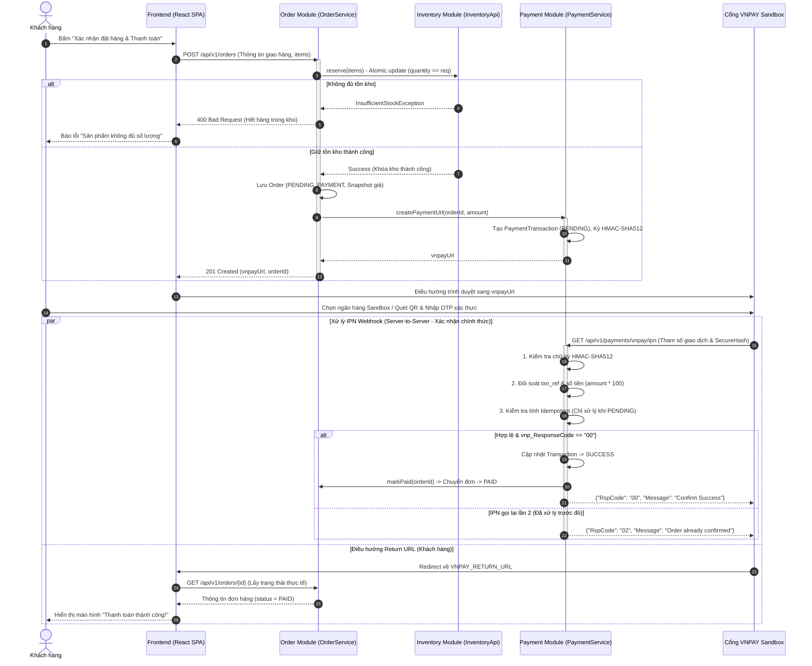
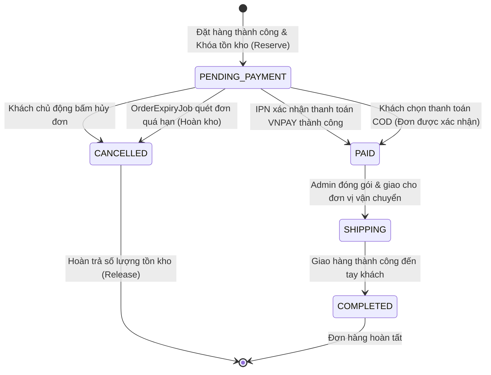
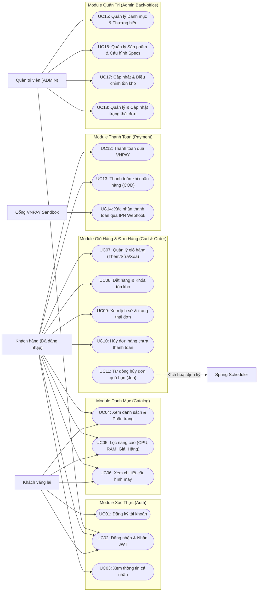
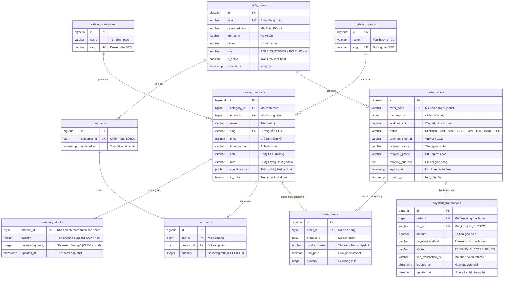
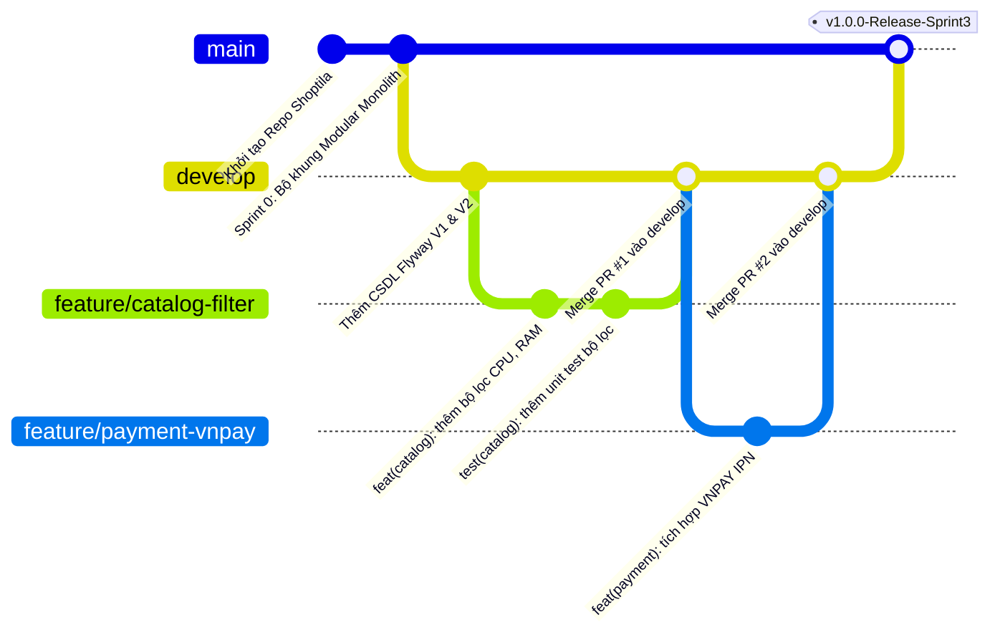
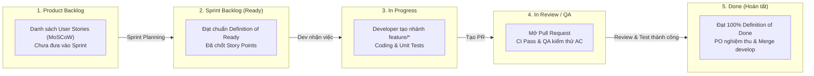

# Shoptila E-Commerce – Tài Liệu Kỹ Thuật & Khởi Tạo Dự Án (Sprint 0)

> **Dự án:** Shoptila – Website thương mại điện tử thiết bị công nghệ  
> **Giai đoạn:** Sprint 0 (Foundation & Architectural Setup)  
> **Thời lượng:** 1 - 2 tuần (Tiền đề trước khi bước vào Sprint 1)  
> **Tài liệu tham chiếu:** `README.md`, `docs/agile-scrum/README.md`  
> **Vị trí tài liệu:** `docs/agile-scrum/sprint-backlog/sprint-0.md`

---

## Mục lục

1. [Mục Tiêu & Định Nghĩa Sprint 0](#1-mục-tiêu--định-nghĩa-sprint-0)
2. [Công Nghệ Sử Dụng (Tech Stack Specification)](#2-công-nghệ-sử-dụng-tech-stack-specification)
3. [Kiến Trúc Hệ Thống (Modular Monolith)](#3-kiến-trúc-hệ-thống-modular-monolith)
   - [Sơ đồ kiến trúc tổng thể (Mermaid Architecture)](#31-sơ-đồ-kiến-trúc-tổng-thể)
   - [Quy tắc ranh giới giữa các Module](#32-quy-tắc-ranh-giới-giữa-các-module)
   - [Sơ đồ tuần tự Đặt hàng & Xác thực VNPAY IPN (Mermaid Sequence)](#33-sơ-đồ-tuần-tự-đặt-hàng--xác-thực-vnpay-ipn)
   - [Sơ đồ trạng thái đơn hàng (Mermaid State Machine)](#34-sơ-đồ-trạng-thái-đơn-hàng)
4. [Sơ Đồ Use Case Tổng Quan (Mermaid Use Case Diagram)](#4-sơ-đồ-use-case-tổng-quan)
5. [Thiết Kế Cơ Sở Dữ Liệu (Mermaid ERD & Schema)](#5-thiết-kế-cơ-sở-dữ-liệu-database-schema--flyway)
6. [Thiết Kế Giao Diện (Wireframe Các Màn Hình Chính)](#6-thiết-kế-giao-diện-wireframe-các-màn-hình-chính)
7. [Thiết Lập Môi Trường (Git Flow, Docker & CI/CD)](#7-thiết-lập-môi-trường-git-branching-docker--cicd)
   - [Sơ đồ phân nhánh Git Flow (Mermaid GitGraph)](#71-cấu-hình-repository--quy-ước-phân-nhánh-git-flow)
   - [Quy ước Commit & Pipeline CI](#72-quy-ước-commit-conventional-commits)
8. [Quản Lý Dự Án (GitHub Projects & Issue Tracking)](#8-quản-lý-dự-án-github-projects--issue-tracking)
   - [Quy trình thẻ Kanban (Mermaid Workflow)](#81-thiết-lập-bảng-github-projects-kanban-board)
   - [Hệ thống Labels & Milestones](#82-hệ-thống-labels-phân-loại)
9. [Checklist Nghiệm Thu Sprint 0 (Sprint 0 Exit Criteria)](#9-checklist-nghiệm-thu-sprint-0-sprint-0-exit-criteria)

---

## 1. Mục Tiêu & Định Nghĩa Sprint 0

Trong mô hình Agile/Scrum, **Sprint 0** (hay *Inception / Foundation Sprint*) không trực tiếp bàn giao tính năng nghiệp vụ cho người dùng cuối (End-user features), mà đóng vai trò **xây dựng nền móng kỹ thuật và quy trình quản lý** nhằm đảm bảo các Sprint tiếp theo (từ Sprint 1 trở đi) diễn ra trơn tru, đúng tiến độ và không bị tắc nghẽn hạ tầng.

### Mục tiêu then chốt của Sprint 0:
1. Thống nhất và thiết lập môi trường phát triển cục bộ và container hóa (Docker Compose).
2. Chuẩn hóa kiến trúc mã nguồn Modular Monolith, thiết lập các module ranh giới rõ ràng.
3. Hoàn thiện thiết kế CSDL khởi tạo (`V1__init.sql`) và dữ liệu mẫu (`V2__seed_data.sql`).
4. Phác thảo Wireframe màn hình chính để Frontend và Backend chốt API contract.
5. Thiết lập quy chuẩn Git Flow, Branching, Conventional Commits và pipeline CI tự động build & test.
6. Khởi tạo bảng Kanban trên **GitHub Projects**, nhập toàn bộ Product Backlog, gán label và ước lượng Story Points.

---

## 2. Công Nghệ Sử Dụng (Tech Stack Specification)

| Tầng / Thành phần | Công nghệ / Thư viện | Phiên bản | Mục đích & Trách nhiệm |
|:---|:---|:---:|:---|
| **Ngôn ngữ Backend** | Java | 17+ LTS | Nền tảng thực thi backend, tận dụng tính năng record, pattern matching, performance tối ưu. |
| **Framework Backend**| Spring Boot | 3.2.x+ | Khung ứng dụng chính: Web MVC, Dependency Injection, Auto-configuration. |
| **Bảo mật & Xác thực** | Spring Security, JJWT, BCrypt | 6.x / 0.12.x | Xác thực người dùng bằng JWT không trạng thái (Stateless), băm mật khẩu an toàn. |
| **Truy xuất dữ liệu** | Spring Data JPA, Hibernate | 6.x | Tương tác CSDL qua ORM, tối ưu hóa Repository pattern và JPQL. |
| **Kiểm tra hợp lệ** | Jakarta Bean Validation | 3.x | Validate dữ liệu đầu vào (DTO) cả cấp Controller và Service. |
| **Cơ sở dữ liệu** | PostgreSQL | 15+ | CSDL quan hệ chính; hỗ trợ index tốt trên JSON, Text, số và các ràng buộc toàn vẹn. |
| **Quản lý Migration** | Flyway | 9.x+ | Quản lý vòng đời lược đồ CSDL theo phiên bản, đảm bảo đồng nhất giữa các môi trường. |
| **Tài liệu hóa API** | springdoc-openapi (Swagger) | 2.x | Tự động sinh tài liệu RESTful API tương tác qua giao diện `/swagger-ui.html`. |
| **Frontend Framework** | React | 18+ | Xây dựng giao diện người dùng theo Component-driven architecture. |
| **Build Tool Frontend** | Vite | 5.x | Build tool siêu tốc cho Frontend, hỗ trợ HMR (Hot Module Replacement) và TS. |
| **Ngôn ngữ Frontend** | TypeScript | 5.x | Đảm bảo tính an toàn kiểu dữ liệu (Type-safe) từ tầng API đến UI. |
| **HTTP Client** | Axios | 1.6+ | Giao tiếp REST API, cấu hình Interceptor đính kèm JWT và bắt lỗi tập trung. |
| **Routing Frontend** | React Router DOM | 6.x | Điều hướng trang đơn (SPA), cấu hình phân quyền RouteGuard (Guest, Customer, Admin). |
| **Kiểm thử Backend** | JUnit 5, Mockito, Testcontainers | Mới nhất | Unit test nghiệp vụ và Integration test với CSDL PostgreSQL thực trong container. |
| **Cổng thanh toán** | VNPAY Sandbox | v2.1.0 | Tích hợp thanh toán trực tuyến qua thẻ ATM, QR Code với HMAC-SHA512 checksum. |
| **Container & Reverse Proxy**| Docker, Docker Compose, Nginx | Mới nhất | Đóng gói toàn bộ hệ thống (Postgres, Backend, Frontend) chạy đồng nhất trên mọi máy. |

---

## 3. Kiến Trúc Hệ Thống (Modular Monolith)

### 3.1. Sơ đồ kiến trúc tổng thể

```mermaid
flowchart TD
    subgraph Clients["Frontend Client Layer"]
        ClientApp["React SPA (Desktop / Mobile)\nVite + TypeScript"]
    end

    subgraph BackendApp["Backend Application (Spring Boot 3 - Modular Monolith)"]
        subgraph CommonLayer["common Module (Kỹ thuật dùng chung)"]
            SecFilter["Security Filter & JWT Verifier"]
            ExHandler["Global Exception Handler (ProblemDetail RFC 7807)"]
            SharedUtils["Jackson Config & Money Utils"]
        end

        subgraph BusinessModules["Business Modules (Package-by-Feature)"]
            AuthMod["auth Module\n(User, Role, JWT Issue)"]
            CatMod["catalog Module\n(Product, Category, Filter Specs)"]
            CartMod["cart Module\n(Cart, CartItem)"]
            InvMod["inventory Module\n(StockItem, Atomic Reserve)"]
            OrderMod["order Module\n(Order, Items, ExpiryJob)"]
            PayMod["payment Module\n(VNPAY, IPN Idempotency, COD)"]
        end
    end

    subgraph ExternalServices["Hạ tầng & Hệ thống bên ngoài"]
        PostgresDB[("PostgreSQL 15 Database\n(Prefix: auth_, catalog_, order_...)")]
        VnpaySandbox["Cổng thanh toán VNPAY Sandbox\n(Redirect & IPN Webhook)"]
    end

    ClientApp -->|HTTP REST / JWT| SecFilter
    SecFilter --> BusinessModules

    CatMod -.->|CatalogApi.getSnapshot()| OrderMod
    CartMod -.->|CartService| OrderMod
    OrderMod -->|InventoryApi.reserve()| InvMod
    OrderMod -->|PaymentApi.createPaymentUrl()| PayMod
    PayMod -->|OrderApi.markPaid()| OrderMod

    BusinessModules -->|Spring Data JPA / Flyway| PostgresDB
    PayMod <-->|Redirect URL & IPN Webhook| VnpaySandbox
```

---

### 3.2. Quy tắc ranh giới giữa các Module (Architectural Rules)

1. **Giao tiếp qua Public Interface (`api/`):**
   - Một module **chỉ được gọi module khác** thông qua interface nằm trong thư mục `api/` (Ví dụ: `InventoryApi.reserve()`, `OrderApi.markPaid()`, `PaymentApi.createPaymentUrl()`).
   - Tuyệt đối cấm import trực tiếp các lớp nội bộ như `@Service`, `@Repository`, hoặc `@Entity` thuộc `domain` của module khác.
2. **Không dùng ràng buộc khóa ngoại JPA chéo module:**
   - Bảng thuộc module này không được dùng `@ManyToOne` hay quan hệ FK cứng đến bảng thuộc module khác; chỉ lưu giữ định danh khóa ngoại dưới dạng số nguyên `id` (Ví dụ: `order_orders` lưu `customer_id`, `order_items` lưu `product_id`).
   - Điều này cho phép tách module thành Database riêng biệt khi chuyển đổi sang Microservices mà không bị vướng liên kết khóa ngoại.
3. **Tiền tố tên bảng:**
   - Tất cả các bảng dữ liệu phải có tiền tố nghiệp vụ: `auth_*`, `catalog_*`, `cart_*`, `inventory_*`, `order_*`, `payment_*`.
4. **Trách nhiệm của `common` module:**
   - Module `common` chỉ chứa các thành phần kỹ thuật dùng chung: cấu hình bảo mật, bộ lọc JWT, xử lý ngoại lệ `ProblemDetail`, định dạng tiền tệ.
   - Quá trình **phát hành Token** thuộc về `auth`, quá trình **xác thực Token** thuộc về `common`.

---

### 3.3. Sơ đồ tuần tự Đặt hàng & Xác thực VNPAY IPN



---

### 3.4. Sơ đồ trạng thái đơn hàng



---

## 4. Sơ Đồ Use Case Tổng Quan



---

## 5. Thiết Kế Cơ Sở Dữ Liệu (Database Schema & Flyway)

Toàn bộ CSDL PostgreSQL được khởi tạo thông qua Flyway migration script `V1__init.sql` đặt tại `backend/src/main/resources/db/migration/`.

### 5.1. Sơ đồ thực thể liên kết (Mermaid ERD)



---

### 5.2. Chi tiết các bảng dữ liệu & Ràng buộc toàn vẹn

1. **Module `auth`:**
   - `auth_users`: Chứa tài khoản người dùng, role phân quyền (`ROLE_CUSTOMER`, `ROLE_ADMIN`), mật khẩu băm BCrypt.
2. **Module `catalog`:**
   - `catalog_categories`, `catalog_brands`, `catalog_products`: Quản lý thông tin thiết bị công nghệ, cấu hình thông số RAM, CPU và JSON specs.
   - **Chỉ mục tối ưu tìm kiếm:**
     - `CREATE INDEX idx_products_price ON catalog_products(price);`
     - `CREATE INDEX idx_products_brand_cat ON catalog_products(brand_id, category_id);`
     - `CREATE INDEX idx_products_cpu_ram ON catalog_products(cpu, ram);`
3. **Module `inventory`:**
   - `inventory_stocks`: Quản lý tồn kho. Câu lệnh trừ kho atomic an toàn đa luồng:
     ```sql
     UPDATE inventory_stocks 
     SET quantity = quantity - :qty, updated_at = NOW() 
     WHERE product_id = :productId AND quantity >= :qty;
     ```
4. **Module `cart`:**
   - `cart_carts`, `cart_items`: Quản lý giỏ hàng, ràng buộc số lượng > 0 và duy nhất cặp `(cart_id, product_id)`.
5. **Module `order`:**
   - `order_orders`, `order_items`: Lưu đơn hàng và snapshot giá/tên tại thời điểm mua, tránh việc giá sản phẩm thay đổi làm sai lệch đơn hàng cũ.
6. **Module `payment`:**
   - `payment_transactions`: Lưu trữ giao dịch, ràng buộc `UNIQUE (txn_ref)` và `UNIQUE (order_id)` đảm bảo nguyên tắc Idempotency khi nhận IPN.

---

## 6. Thiết Kế Giao Diện (Wireframe Các Màn Hình Chính)

### Wireframe 1: Trang Chủ & Tìm Kiếm / Lọc Sản Phẩm (`/` hoặc `/products`)

```
+------------------------------------------------------------------------------------+
|  [LOGO] SHOPTILA     [  Tìm kiếm laptop, linh kiện...   [Tìm] ]   (Giỏ: 2) [Đăng nhập] |
+------------------------------------------------------------------------------------+
|  Trang chủ  |  Laptop Gaming  |  MacBook  |  PC Đồ Họa  |  Phụ Kiện                |
+------------------------------------------------------------------------------------+
| BỘ LỌC TÌM KIẾM           | DANH SÁCH SẢN PHẨM (Hiển thị 1-12 trong 86 sản phẩm)   |
|                           | Sắp xếp: [ Giá thấp đến cao | Mới nhất v ]             |
| Khoảng giá (VND):         |--------------------------------------------------------|
| (o) Tất cả                | [Ảnh Sản Phẩm]          [Ảnh Sản Phẩm]                 |
| ( ) Dưới 15 triệu         | Laptop Asus TUF A15     MacBook Air M2 16GB            |
| ( ) 15 - 25 triệu         | CPU: Ryzen 7 7735HS     CPU: Apple M2                  |
| ( ) Trên 25 triệu         | RAM: 16GB DDR5          RAM: 16GB Unified              |
|                           | 21.990.000 đ            26.490.000 đ                   |
| Hãng sản xuất:            | [Xem chi tiết] [Mua]    [Xem chi tiết] [Mua]           |
| [x] Asus      [ ] Dell    |--------------------------------------------------------|
| [x] Apple     [ ] Lenovo  | [Ảnh Sản Phẩm]          [Ảnh Sản Phẩm]                 |
|                           | Laptop Dell Inspiron    Lenovo Legion 5 Pro            |
| Dung lượng RAM:           | CPU: Core i5 1335U      CPU: Core i7 13700HX           |
| [ ] 8GB       [x] 16GB    | RAM: 16GB DDR4          RAM: 32GB DDR5                 |
| [ ] 32GB      [ ] 64GB    | 16.290.000 đ            35.990.000 đ                   |
|                           | [Xem chi tiết] [Mua]    [Xem chi tiết] [Mua]           |
| Vi xử lý (CPU):           |--------------------------------------------------------|
| [x] Intel Core i7         |           [ < Trang trước ]  [1] [2] [3]  [ Trang sau > ]   |
| [ ] AMD Ryzen 7           |                                                        |
| [Áp dụng] [Xóa bộ lọc]    |                                                        |
+---------------------------+--------------------------------------------------------+
```

---

### Wireframe 2: Trang Chi Tiết Sản Phẩm (`/products/:slug`)

```
+------------------------------------------------------------------------------------+
|  [LOGO] SHOPTILA                                                  (Giỏ: 2) [Nguyễn Văn A]
+------------------------------------------------------------------------------------+
| Trang chủ > Laptop > Asus > Laptop Asus TUF Gaming A15 FA507NU
+------------------------------------------------------------------------------------+
|  [ ẢNH CHÍNH SẢN PHẨM ]     |  Laptop Asus TUF Gaming A15 (2023)
|                             |  Mã SP: ASUS-FA507NU-01
|  +-----------------------+  |  Thương hiệu: ASUS | Tình trạng: [Còn hàng (12 máy)]
|  |                       |  |-----------------------------------------------------
|  |      [ẢNH TO]         |  |  GIÁ BÁN: 21.990.000 ₫   (Tiết kiệm: 2.000.000 ₫)
|  |                       |  |  Giá niêm yết: 23.990.000 ₫
|  +-----------------------+  |-----------------------------------------------------
|  [Thumb 1] [Thumb 2] [Thumb]|  Chọn cấu hình:
|                             |  RAM: [ 16GB DDR5 (Mặc định) ]   [ 32GB DDR5 (+1.5tr) ]
|-----------------------------|  Ổ cứng: [ SSD 512GB NVMe ]      [ SSD 1TB NVMe ]
|  THÔNG SỐ KỸ THUẬT CHI TIẾT |-----------------------------------------------------
|  • CPU: AMD Ryzen 7 7735HS  |  Số lượng: [ - ] [ 1 ] [ + ]  (Tối đa 12)
|  • GPU: NVIDIA RTX 4050 6GB |
|  • RAM: 16GB DDR5 4800MHz   |  [ THÊM VÀO GIỎ HÀNG ]      [ MUA NGAY QUA VNPAY ]
|  • Màn hình: 15.6" FHD 144Hz|
|  • Trọng lượng: 2.2 kg      |  (Miễn phí giao hàng toàn quốc - Bảo hành chính hãng 24T)
+-----------------------------+-----------------------------------------------------+
```

---

### Wireframe 3: Giỏ Hàng Mua Sắm (`/cart`)

```
+------------------------------------------------------------------------------------+
|  [LOGO] SHOPTILA               GIỎ HÀNG CỦA BẠN (2 món)           [Tiếp tục mua hàng]
+------------------------------------------------------------------------------------+
| SẢN PHẨM                  ĐƠN GIÁ         SỐ LƯỢNG      THÀNH TIỀN       THAO TÁC   |
|------------------------------------------------------------------------------------|
| [Ảnh] Laptop Asus TUF A15  21.990.000 ₫    [ - ] 1 [ + ]  21.990.000 ₫    [ Xóa ]   |
|       Màu: Xám, RAM 16GB                                                           |
|------------------------------------------------------------------------------------|
| [Ảnh] Chuột Asus ROG M4    890.000 ₫      [ - ] 2 [ + ]   1.780.000 ₫    [ Xóa ]   |
|       Màu: Đen                                                                     |
+------------------------------------------------------------------------------------+
| [X Xóa toàn bộ giỏ hàng]                  | TẠM TÍNH:             23.770.000 ₫     |
|                                           | Phí vận chuyển:       Miễn phí         |
|                                           | TỔNG CỘNG:            23.770.000 ₫     |
|                                           |----------------------------------------|
|                                           | [ TIẾN HÀNH ĐẶT HÀNG & THANH TOÁN -> ] |
+------------------------------------------+-----------------------------------------+
```

---

### Wireframe 4: Đặt Hàng & Chọn Phương Thức Thanh Toán (`/checkout`)

```
+------------------------------------------------------------------------------------+
|  [LOGO] SHOPTILA                      TIẾN HÀNH ĐẶT HÀNG                           |
+------------------------------------------------------------------------------------+
| 1. THÔNG TIN NHẬN HÀNG                   | 2. ĐƠN HÀNG CỦA BẠN                     |
|                                          |-----------------------------------------|
| Họ và tên người nhận (*):                | • Laptop Asus TUF A15 (x1): 21.990.000₫ |
| [ Nguyễn Văn A                         ] | • Chuột ROG M4 (x2):         1.780.000₫ |
| Số điện thoại (*):                       | Tạm tính:                   23.770.000₫ |
| [ 0987654321                           ] | Phí ship:                   0₫          |
| Tỉnh / Thành phố (*):                    | TỔNG THANH TOÁN:            23.770.000₫ |
| [ TP. Hồ Chí Minh                    v ] |-----------------------------------------|
| Quận / Huyện (*):                        | 3. PHƯƠNG THỨC THANH TOÁN               |
| [ Quận 1                             v ] |                                         |
| Địa chỉ giao hàng cụ thể (*):            | (o) Cổng thanh toán VNPAY (Khuyên dùng) |
| [ 123 Đường Lê Lợi, Phường Bến Nghé    ] |     [Thẻ ATM / Internet Banking / QR]   |
| Ghi chú đơn hàng:                        | ( ) Thanh toán tiền mặt khi nhận (COD)  |
| [ Giao hàng giờ hành chính             ] |                                         |
|                                          | [X] Tôi đồng ý điều khoản mua bán hàng  |
|                                          |-----------------------------------------|
|                                          | [     XÁC NHẬN ĐẶT HÀNG & THANH TOÁN    |
+------------------------------------------+-----------------------------------------+
```

---

### Wireframe 5: Kết Quả Thanh Toán & Trạng Thái Đơn (`/payment/result`)

```
+------------------------------------------------------------------------------------+
|  [LOGO] SHOPTILA                                                  [Đơn hàng của tôi]
+------------------------------------------------------------------------------------+
|                                                                                    |
|                        [ ICON THÀNH CÔNG: MÀU XANH LÁ ]                            |
|                       THANH TOÁN ĐƠN HÀNG THÀNH CÔNG!                              |
|           Cảm ơn quý khách đã mua sắm thiết bị công nghệ tại Shoptila              |
|                                                                                    |
|   +----------------------------------------------------------------------------+   |
|   | THÔNG TIN GIAO DỊCH                                                        |   |
|   | • Mã đơn hàng:           #ORD-20261116-8921                                |   |
|   | • Mã giao dịch VNPAY:    14829103                                          |   |
|   | • Số tiền đã thanh toán: 23.770.000 ₫                                      |   |
|   | • Ngân hàng:             NCB (Sandbox)                                     |   |
|   | • Thời gian thanh toán:  16/11/2026 15:30:45                               |   |
|   | • Trạng thái đơn:        [ ĐÃ THANH TOÁN (PAID) ]                          |   |
|   | • Địa chỉ giao:          123 Đường Lê Lợi, Quận 1, TP. Hồ Chí Minh         |   |
|   +----------------------------------------------------------------------------+   |
|                                                                                    |
|                  [ TIẾP TỤC MUA SẮM ]       [ XEM CHI TIẾT ĐƠN HÀNG ]              |
+------------------------------------------------------------------------------------+
```

---

### Wireframe 6: Màn Hình Quản Trị Đơn Hàng Của Admin (`/admin/orders`)

```
+------------------------------------------------------------------------------------+
|  SHOPTILA ADMIN PORTAL          Xin chào: Admin (Quản trị viên)     [ Đăng xuất ]   |
+------------------------------------------------------------------------------------+
| [MENU ADMIN]       | QUẢN LÝ DANH SÁCH ĐƠN HÀNG                                    |
| • Dashboard        | Lọc: Trạng thái [ Tất cả | PAID | SHIPPING v ]  [Tìm mã đơn]   |
| • Quản lý sản phẩm |---------------------------------------------------------------|
| • Danh mục & Hãng  | MÃ ĐƠN     KHÁCH HÀNG     NGÀY ĐẶT    TỔNG TIỀN     TRẠNG THÁI|
| • Quản lý tồn kho  | #ORD-8921  Nguyễn Văn A   16/11/2026  23.770.000₫   [ PAID    |
| • Quản lý đơn hàng |            (0987654321)                             [Giao hàng|
| • Báo cáo thống kê | #ORD-8920  Trần Thị B     16/11/2026   1.250.000₫   [SHIPPING |
|                    |            (0912345678)                             [Hoàn tất |
|                    | #ORD-8919  Lê Hoàng C     15/11/2026  32.000.000₫   [CANCELLED|
|                    |---------------------------------------------------------------|
|                    | Thao tác nhanh: [ Xem chi tiết đơn ]  [ Cập nhật trạng thái ]  |
+--------------------+---------------------------------------------------------------+
```

---

## 7. Thiết Lập Môi Trường (Git, Branching, Docker & CI/CD)

### 7.1. Cấu hình Repository & Quy ước phân nhánh (Git Flow)



- **`main`:** Nhánh phát hành chính (Production-ready). Chỉ merge từ `develop` khi kết thúc Sprint hoặc Release; được bảo vệ (Protected), yêu cầu ít nhất 1 Tech Lead approve.
- **`develop`:** Nhánh tích hợp chính hàng ngày. Mọi tính năng hoàn thành đều merge vào nhánh này.
- **`feature/<module>-<tên-ngắn-gọn>`:** Nhánh phát triển tính năng mới. Tách ra từ `develop` và merge lại vào `develop` qua Pull Request.
  - *Ví dụ:* `"feature/catalog-filter"`, `"feature/payment-vnpay"`, `feature/inventory-concurrency`.
- **`bugfix/<mô-tả>`:** Nhánh sửa lỗi trong quá trình testing trên `develop`.
- **`hotfix/<mô-tả>`:** Nhánh vá lỗi khẩn cấp trực tiếp từ `main`.

---

### 7.2. Quy ước Commit (Conventional Commits)

Format: `<type>(<scope>): <subject>`

- `feat`: Tính năng mới (Ví dụ: `feat(payment): implement VNPAY IPN webhook handler`).
- `fix`: Sửa lỗi (Ví dụ: `fix(inventory): prevent negative stock on concurrent checkouts`).
- `docs`: Sửa tài liệu (Ví dụ: `docs(scrum): update sprint 0 technical specifications`).
- `test`: Bổ sung kiểm thử (Ví dụ: `test(payment): add unit tests for HMAC-SHA512 checksum`).
- `refactor`: Tái cấu trúc mã nguồn không thay đổi nghiệp vụ.
- `chore`: Cấu hình Maven, Docker, CI/CD.

---

### 7.3. Cấu hình Continuous Integration (GitHub Actions)

Tạo file `.github/workflows/ci.yml` để tự động kiểm thử mỗi khi tạo Pull Request vào `develop` hoặc `main`:

```yaml
name: Shoptila CI Pipeline

on:
  push:
    branches: [ develop, main ]
  pull_request:
    branches: [ develop, main ]

jobs:
  backend-test:
    name: Backend Build & Test (Java 17)
    runs-on: ubuntu-latest

    services:
      postgres:
        image: postgres:15-alpine
        env:
          POSTGRES_DB: shoptila_test
          POSTGRES_USER: test_user
          POSTGRES_PASSWORD: test_password
        ports:
          - 5432:5432
        options: >-
          --health-cmd pg_isready
          --health-interval 10s
          --health-timeout 5s
          --health-retries 5

    steps:
      - name: Checkout Source Code
        uses: actions/checkout@v4

      - name: Set up JDK 17
        uses: actions/setup-java@v4
        with:
          java-version: '17'
          distribution: 'temurin'
          cache: 'maven'

      - name: Run Backend Tests
        run: |
          cd backend
          mvn clean test -Dspring.profiles.active=test

  frontend-build:
    name: Frontend Lint & Build (Node 18)
    runs-on: ubuntu-latest

    steps:
      - name: Checkout Source Code
        uses: actions/checkout@v4

      - name: Set up Node.js 18
        uses: actions/setup-node@v4
        with:
          node-version: 18
          cache: 'npm'
          cache-dependency-path: frontend/package-lock.json

      - name: Install & Build Frontend
        run: |
          cd frontend
          npm ci
          npm run build

  docker-compose-validate:
    name: Validate Docker Compose Configuration
    runs-on: ubuntu-latest
    steps:
      - name: Checkout Source Code
        uses: actions/checkout@v4
      - name: Validate Compose File
        run: docker compose config
```

---

## 8. Quản Lý Dự Án (GitHub Projects & Issue Tracking)

> **Bảng GitHub Projects chính thức:** [Shoptila E-Commerce - Product Backlog](https://github.com/users/nhani05/projects/4)  
> **Repository liên kết:** [`nhani05/shoptila-ecommerce`](https://github.com/nhani05/shoptila-ecommerce)  
> **Trạng thái:** Đã nạp đầy đủ **25 User Stories** vào cột **Product Backlog** (chưa phân bổ vào Sprint Backlog).

### 8.1. Thiết lập Bảng GitHub Projects (Kanban Board)



---

### 8.2. Hệ thống Labels phân loại

| Nhóm Label | Tên Label | Màu sắc | Mục đích sử dụng |
|:---|:---|:---:|:---|
| **Loại Issue** | `type:epic` | Tím | Đánh dấu Epic cha. |
| | `type:story` | Xanh dương | User Story nghiệp vụ. |
| | `type:task` | Xanh lá | Công việc kỹ thuật/Setup hạ tầng. |
| | `type:bug` | Đỏ | Lỗi phát sinh trong kiểm thử. |
| **Phân loại MoSCoW** | `priority:must-have` | Đỏ đậm | Bắt buộc cho MVP. |
| | `priority:should-have` | Cam | Rất quan trọng nhưng có thể lùi nhẹ. |
| | `priority:could-have` | Vàng | Tính năng gia tăng giá trị. |
| | `priority:wont-have` | Xám | Chưa thực hiện ở phiên bản này. |
| **Module phụ trách** | `module:auth`, `module:catalog`, `module:cart`, `module:order`, `module:payment`, `module:inventory` | Màu pastel | Chỉ định ranh giới module code. |
| **Ước lượng (SP)** | `sp:1`, `sp:2`, `sp:3`, `sp:5`, `sp:8`, `sp:13` | Trắng | Điểm Story Point ước lượng. |

---

### 8.3. Danh sách Milestones

1. **`Sprint 0: Architecture, Setup & Wireframes`** (Tuần 0 - Hoàn thành nền tảng).
2. **`Sprint 1: Auth & Product Catalog Discovery`** (Tuần 1 - 2, 19 SP).
3. **`Sprint 2: Cart & Inventory Safe Order`** (Tuần 3 - 4, 22 SP).
4. **`Sprint 3: VNPAY Payment & Admin Order Processing`** (Tuần 5 - 6, 26 SP - MVP Launch).
5. **`Sprint 4: Profile, Polish & Release v1.0`** (Tuần 7 - 8, 15 SP).

---

## 9. Checklist Nghiệm Thu Sprint 0 (Sprint 0 Exit Criteria)

Trước khi tổ chức buổi họp **Sprint 1 Planning**, toàn bộ nhóm phải hoàn thành và tích chọn đầy đủ các tiêu chí dưới đây:

- [ ] **Kiến trúc & CSDL:**
  - [ ] Cấu trúc thư mục modular monolith (`auth`, `catalog`, `cart`, `inventory`, `order`, `payment`, `common`) đã được tạo sẵn bộ khung.
  - [ ] File migration `V1__init.sql` tạo đầy đủ bảng, khóa, chỉ mục index và chạy thành công trên PostgreSQL.
  - [ ] File migration `V2__seed_data.sql` có dữ liệu mẫu danh mục, thương hiệu, tài khoản admin demo.
- [ ] **Môi trường & Docker:**
  - [ ] File `.env.example` đầy đủ các biến môi trường cấu hình JWT, DB, VNPAY Sandbox.
  - [ ] Lệnh `docker compose up --build` khởi động thành công cả Frontend, Backend và CSDL Postgres không lỗi.
- [ ] **Giao diện & Tài liệu:**
  - [ ] Toàn bộ 6 Wireframe chính đã được thống nhất giữa Designer/Frontend và Backend.
  - [ ] Swagger UI (`/swagger-ui.html`) hiển thị đầy đủ thông tin chuẩn ProblemDetail.
- [ ] **Quy trình & Quản lý:**
  - [ ] GitHub Repository đã cấu hình nhánh `main`, `develop` và bật branch protection.
  - [ ] Workflow GitHub Actions CI chạy pass cả Backend test và Frontend build.
  - [ ] Bảng **GitHub Projects** đã được tạo, 25 User Stories đã được nhập thành Issue kèm đầy đủ Label, Milestones và Story Points.

---
*Tài liệu Sprint 0 hoàn thành – Toàn đội ngũ sẵn sàng bước vào Sprint 1!*
