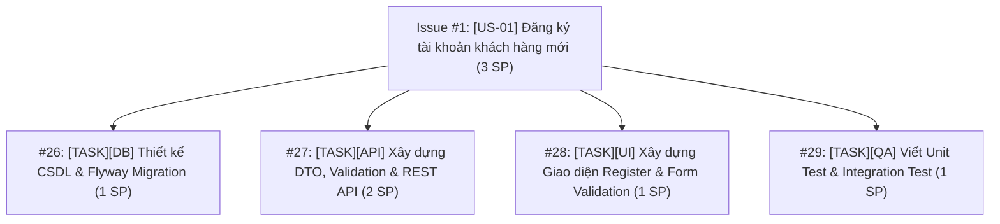
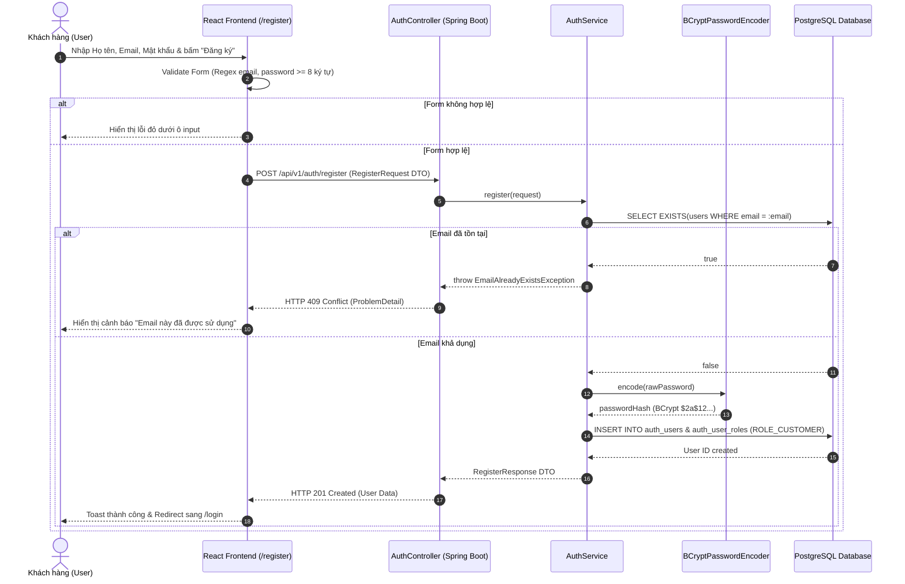

# Shoptila E-Commerce – Kế Hoạch Sprint 1 & Sprint Backlog Chi Tiết (Sprint 1.1)

> **Dự án:** Shoptila – Website thương mại điện tử thiết bị công nghệ  
> **Sprint:** Sprint 1 (Sprint 1.1 – Trọng tâm Nền tảng Xác thực & Khám phá sản phẩm)  
> **Thời gian thực hiện:** 2 tuần (10 ngày làm việc)  
> **Milestone GitHub:** [`Sprint 1: Auth & Product Catalog Discovery`](https://github.com/nhani05/shoptila-ecommerce/milestone/1)  
> **Bảng GitHub Projects:** [Shoptila E-Commerce - Product Backlog & Kanban](https://github.com/users/nhani05/projects/4)  
> **Nhánh thực hiện:** `feature/us-01-auth-register`  
> **Trọng tâm phân rã:** **[US-01] Đăng ký tài khoản khách hàng mới**

---

## Mục lục

1. [Tổng Quan Buổi Họp Sprint Planning (Sprint 1)](#1-tổng-quan-buổi-họp-sprint-planning-sprint-1)
2. [Sprint Goal (Mục Tiêu Sprint 1)](#2-sprint-goal-mục-tiêu-sprint-1)
3. [Lựa Chọn User Stories Từ Product Backlog Vào Sprint Backlog](#3-lựa-chọn-user-stories-từ-product-backlog-vào-sprint-backlog)
4. [Phân Rã Kỹ Thuật Chi Tiết Cho Trọng Tâm [US-01]](#4-phân-rã-kỹ-thuật-chi-tiết-cho-trọng-tâm-us-01)
   - [Task 1 (#26): Thiết Kế CSDL & Flyway Migration](#41-task-1-26-thiết-kế-csdl--flyway-migration-db)
   - [Task 2 (#27): Xây Dựng DTO, Validation, Service & REST API](#42-task-2-27-xây-dựng-dto-validation-service--rest-api-backend)
   - [Task 3 (#28): Xây Dựng Giao Diện Người Dùng & Form Validation](#43-task-3-28-xây-dựng-giao-diện-người-dùng--form-validation-frontend)
   - [Task 4 (#29): Kế Hoạch Kiểm Thử Tự Động & Độ Phủ Code](#44-task-4-29-kế-hoạch-kiểm-thử-tự-động--độ-phủ-code-testqa)
5. [Thiết Kế Wireframe & Luồng Trải Nghiệm US-01](#5-thiết-kế-wireframe--luồng-trải-nghiệm-us-01)
6. [Phân Bổ Kỹ Thuật Các User Story Khác Trong Sprint 1](#6-phân-bổ-kỹ-thuật-các-user-story-khác-trong-sprint-1)
7. [Quản Lý & Vận Hành Trên GitHub Projects Board](#7-quản-lý--vận-hành-trên-github-projects-board)
8. [Quy Chuẩn Kiểm Soát Chất Lượng (DoR & DoD)](#8-quy-chuẩn-kiểm-soát-chất-lượng-dor--dod)

---

## 1. Tổng Quan Buổi Họp Sprint Planning (Sprint 1)

Buổi họp **Sprint Planning** cho Sprint 1 được tổ chức với sự tham gia đầy đủ của các vai trò trong Scrum Team:
- **Product Owner (PO):** Làm rõ yêu cầu nghiệp vụ của các User Story trong Epic Quản lý định danh (Auth) và Khám phá sản phẩm (Catalog).
- **Scrum Master (SM):** Hướng dẫn quy trình, kiểm tra Definition of Ready (DoR), đảm bảo không vượt quá công suất (Velocity capacity) của nhóm.
- **Development Team (5 thành viên):** Thảo luận giải pháp kiến trúc Modular Monolith, chia nhỏ story thành các task kỹ thuật khả thi, cam kết chất lượng theo Definition of Done (DoD).

### Thông số năng lực của nhóm (Team Capacity):
- **Quy mô nhóm:** 1 Tech Lead / Full-stack, 2 Backend Developers, 2 Frontend Developers, 1 QA Tester.
- **Tổng ngày làm việc:** 10 ngày (2 tuần) x 6 người = 60 man-days.
- **Hệ số khả dụng thực tế:** 80% (trừ hội họp Scrum, code review, rủi ro) = ~48 man-days.
- **Velocity mục tiêu cam kết:** **19 Story Points** (Phù hợp với ước lượng lý tưởng 18 - 22 SP/sprint).

---

## 2. Sprint Goal (Mục Tiêu Sprint 1)

> **Sprint Goal chính thức:**  
> *"Xây dựng nền tảng xác thực an toàn (đăng ký tài khoản mới mã hóa BCrypt, đăng nhập và cấp phát JWT không trạng thái) cùng trải nghiệm khám phá sản phẩm công nghệ mượt mà (danh sách có phân trang, bộ lọc đa tiêu chí CPU/RAM/Thương hiệu/Giá và phân hệ quản trị danh mục Admin) trên kiến trúc Modular Monolith."*

### Mục tiêu thành công cụ thể đối với [US-01] Đăng ký tài khoản:
- Khách hàng mới có thể truy cập `/register`, nhập thông tin và đăng ký tài khoản thành công với email hợp lệ.
- Mật khẩu người dùng được băm an toàn 100% bằng thuật toán BCrypt trước khi lưu trữ vào PostgreSQL.
- Tự động gán quyền truy cập mặc định `ROLE_CUSTOMER`.
- Phản hồi HTTP đạt chuẩn RFC 7807 `ProblemDetail`: Trả về `201 Created` khi thành công; trả về `409 Conflict` kèm thông điệp rõ ràng khi email đã tồn tại.

---

## 3. Lựa Chọn User Stories Từ Product Backlog Vào Sprint Backlog

Dựa trên thứ tự ưu tiên của mô hình **MoSCoW**, toàn bộ các User Story được chọn vào Sprint 1 đều là **Must-Have** (Bắt buộc phải có cho MVP nền tảng) và đã đạt 100% tiêu chí **Definition of Ready (DoR)**:

| Story ID | Tên User Story | Epic | MoSCoW | Story Points | Issue GitHub | Trạng thái Board |
|:---:|:---|:---:|:---:|:---:|:---:|:---:|
| **US-01** | Đăng ký tài khoản khách hàng mới | EPIC-01 Auth | **Must** | **3 SP** | [#1](https://github.com/nhani05/shoptila-ecommerce/issues/1) | **Sprint Backlog** |
| **US-02** | Đăng nhập hệ thống và cấp phát JWT | EPIC-01 Auth | **Must** | **3 SP** | [#2](https://github.com/nhani05/shoptila-ecommerce/issues/2) | **Sprint Backlog** |
| **US-04** | Xem danh sách sản phẩm & Phân trang | EPIC-02 Catalog | **Must** | **3 SP** | [#4](https://github.com/nhani05/shoptila-ecommerce/issues/4) | **Sprint Backlog** |
| **US-05** | Tìm kiếm & Lọc sản phẩm theo CPU, RAM, Hãng, Giá | EPIC-02 Catalog | **Must** | **5 SP** | [#5](https://github.com/nhani05/shoptila-ecommerce/issues/5) | **Sprint Backlog** |
| **US-06** | Xem chi tiết thông số kỹ thuật sản phẩm | EPIC-02 Catalog | **Must** | **2 SP** | [#6](https://github.com/nhani05/shoptila-ecommerce/issues/6) | **Sprint Backlog** |
| **US-17** | Admin quản lý danh mục và thương hiệu | EPIC-06 Admin | **Must** | **3 SP** | [#17](https://github.com/nhani05/shoptila-ecommerce/issues/17) | **Sprint Backlog** |
| **TỔNG CỘNG** | **6 User Stories nền tảng** | - | - | **19 SP** | - | **100% In Sprint** |

> *Ghi chú:* 19 User Stories còn lại tiếp tục được giữ nguyên tại cột **Product Backlog** trên GitHub Projects để phục vụ cho Sprint 2 (Cart & Order), Sprint 3 (Payment VNPAY) và Sprint 4 (Release & Polish).

---

## 4. Phân Rã Kỹ Thuật Chi Tiết Cho Trọng Tâm [US-01]

User Story **[US-01] Đăng ký tài khoản khách hàng mới (3 SP)** được nhóm kỹ thuật phân rã thành **4 task kỹ thuật độc lập** gắn nhãn `#type:task`, tạo dưới dạng GitHub Sub-issues liên kết trực tiếp vào Issue cha [#1](https://github.com/nhani05/shoptila-ecommerce/issues/1).



---

### 4.1. Task 1 (#26): Thiết Kế CSDL & Flyway Migration (DB)
- **Issue liên kết:** [#26](https://github.com/nhani05/shoptila-ecommerce/issues/26)  
- **Ước lượng:** 1 SP (~ 0.5 - 1 ngày làm việc)  
- **Phụ trách:** Backend Lead / Database Specialist  
- **Mục tiêu:** Tạo lược đồ lưu trữ thông tin tài khoản người dùng và phân quyền, hỗ trợ mở rộng, bảo mật cao.

#### Chi tiết kỹ thuật thực thi:
1. Tạo file migration Flyway: `backend/src/main/resources/db/migration/V1__init_auth_schema.sql`
2. Lược đồ bảng `auth_users`:
   ```sql
   CREATE TABLE auth_users (
       id BIGSERIAL PRIMARY KEY,
       email VARCHAR(150) NOT NULL,
       password_hash VARCHAR(255) NOT NULL,
       full_name VARCHAR(100) NOT NULL,
       phone_number VARCHAR(20),
       status VARCHAR(30) DEFAULT 'ACTIVE' NOT NULL,
       created_at TIMESTAMP WITH TIME ZONE DEFAULT CURRENT_TIMESTAMP NOT NULL,
       updated_at TIMESTAMP WITH TIME ZONE DEFAULT CURRENT_TIMESTAMP NOT NULL,
       CONSTRAINT uq_auth_users_email UNIQUE (email)
   );

   CREATE INDEX idx_auth_users_email ON auth_users (email);
   ```
3. Lược đồ bảng `auth_roles` & bảng nối `auth_user_roles`:
   ```sql
   CREATE TABLE auth_roles (
       id BIGSERIAL PRIMARY KEY,
       name VARCHAR(50) NOT NULL UNIQUE
   );

   INSERT INTO auth_roles (name) VALUES ('ROLE_CUSTOMER'), ('ROLE_ADMIN')
   ON CONFLICT (name) DO NOTHING;

   CREATE TABLE auth_user_roles (
       user_id BIGINT NOT NULL,
       role_id BIGINT NOT NULL,
       PRIMARY KEY (user_id, role_id),
       CONSTRAINT fk_user_roles_user FOREIGN KEY (user_id) REFERENCES auth_users (id) ON DELETE CASCADE,
       CONSTRAINT fk_user_roles_role FOREIGN KEY (role_id) REFERENCES auth_roles (id) ON DELETE CASCADE
   );
   ```
4. **Tiêu chí nghiệm thu (AC):**
   - Script chạy thành công với lệnh `flyway:migrate`.
   - Ràng buộc `UNIQUE (email)` ngăn chặn triệt để việc trùng lặp dữ liệu ở tầng persistence.
   - Thử nghiệm rollback và tương thích CSDL PostgreSQL 15+.

---

### 4.2. Task 2 (#27): Xây Dựng DTO, Validation, Service & REST API (Backend)
- **Issue liên kết:** [#27](https://github.com/nhani05/shoptila-ecommerce/issues/27)  
- **Ước lượng:** 2 SP (~ 1.5 ngày làm việc)  
- **Phụ trách:** Backend Developer  
- **Mục tiêu:** Cung cấp RESTful API đăng ký tuân thủ chuẩn Clean Architecture và RFC 7807 ProblemDetail.

#### Chi tiết kỹ thuật thực thi:
1. **Gói mã nguồn (Package structure):**
   - DTOs: `com.example.shop.auth.web.dto.RegisterRequest`, `RegisterResponse`
   - Domain Entities: `com.example.shop.auth.domain.User`, `Role`
   - Repository: `com.example.shop.auth.repository.UserRepository`, `RoleRepository`
   - Service: `com.example.shop.auth.service.AuthService`, `AuthServiceImpl`
   - Controller: `com.example.shop.auth.web.AuthController`
   - Exception Handling: `com.example.shop.common.exception.EmailAlreadyExistsException`, `GlobalExceptionHandler`
2. **Quy chuẩn Validation DTO (`RegisterRequest`):**
   ```java
   public record RegisterRequest(
       @NotBlank(message = "Email không được để trống")
       @Email(message = "Định dạng email không hợp lệ")
       String email,

       @NotBlank(message = "Mật khẩu không được để trống")
       @Pattern(
           regexp = "^(?=.*[a-z])(?=.*[A-Z])(?=.*\\d).{8,}$",
           message = "Mật khẩu tối thiểu 8 ký tự, bao gồm ít nhất 1 chữ hoa, 1 chữ thường và 1 chữ số"
       )
       String password,

       @NotBlank(message = "Họ và tên không được để trống")
       @Size(min = 2, max = 100, message = "Họ và tên phải từ 2 đến 100 ký tự")
       String fullName,

       @Pattern(regexp = "^(0|\\+84)[3|5|7|8|9][0-9]{8}$", message = "Số điện thoại Việt Nam không hợp lệ")
       String phoneNumber
   ) {}
   ```
3. **Nghiệp vụ Service (`AuthServiceImpl`):**
   - Kiểm tra `userRepository.existsByEmail(request.email())`. Nếu `true`, ném `EmailAlreadyExistsException("Email đã được đăng ký trong hệ thống")`.
   - Mã hóa mật khẩu: `passwordEncoder.encode(request.password())` sử dụng `BCryptPasswordEncoder(strength = 12)`.
   - Tìm role `ROLE_CUSTOMER` từ `roleRepository`, gán vào user mới.
   - Lưu vào CSDL và trả về `RegisterResponse(userId, email, fullName, status, createdAt)`.
4. **Cấu hình Exception Handler & API Contract (RFC 7807):**
   - Endpoint: `POST /api/v1/auth/register`
   - Thành công: HTTP Status `201 Created`
   - Lỗi trùng email: HTTP Status `409 Conflict`
     ```json
     {
       "type": "https://api.shoptila.com/errors/email-already-exists",
       "title": "Email Conflict",
       "status": 409,
       "detail": "Email 'khachhang@gmail.com' đã được sử dụng.",
       "instance": "/api/v1/auth/register"
     }
     ```
   - Lỗi validation: HTTP Status `400 Bad Request` trả về danh sách trường vi phạm.

---

### 4.3. Task 3 (#28): Xây Dựng Giao Diện Người Dùng & Form Validation (Frontend)
- **Issue liên kết:** [#28](https://github.com/nhani05/shoptila-ecommerce/issues/28)  
- **Ước lượng:** 1 SP (~ 1 ngày làm việc)  
- **Phụ trách:** Frontend Developer  
- **Mục tiêu:** Xây dựng màn hình đăng ký trực quan, phản hồi tức thời lỗi người dùng (instant client validation) và tích hợp API.

#### Chi tiết kỹ thuật thực thi:
1. **Cấu trúc Component:**
   - Trang: `frontend/src/features/auth/pages/RegisterPage.tsx`
   - Thành phần: `RegisterForm.tsx`, `PasswordStrengthMeter.tsx`
   - API Hook: `useRegisterMutation` sử dụng Axios client dùng chung.
2. **Kiểm tra hợp lệ phía Client (Real-time Feedback):**
   - Email format: hiển thị tick xanh nếu đúng định dạng email.
   - Thanh đo độ mạnh mật khẩu (Password Strength):
     - Dưới 8 ký tự: Báo Đỏ (Yếu).
     - Đủ 8 ký tự + chữ số: Báo Vàng (Trung bình).
     - Đủ 8 ký tự + hoa + thường + số: Báo Xanh lá (Mạnh).
   - Xác nhận mật khẩu (Confirm Password): Báo lỗi ngay lập tức nếu hai mật khẩu chưa khớp.
3. **Trải nghiệm tương tác (UX State Management):**
   - Khi bấm submit: Nút "Đăng ký" chuyển sang trạng thái Loading (Spinner), disable các ô input để tránh double-submit.
   - Khi nhận `409 Conflict`: Đánh dấu viền đỏ ô Email và hiển thị câu thông báo lỗi "Email này đã được đăng ký, vui lòng đăng nhập hoặc dùng email khác".
   - Khi thành công `201`: Hiển thị Toast thông báo "Đăng ký tài khoản thành công!", tự động điều hướng sang `/login` sau 1.5 giây.

---

### 4.4. Task 4 (#29): Kế Hoạch Kiểm Thử Tự Động & Độ Phủ Code (Test/QA)
- **Issue liên kết:** [#29](https://github.com/nhani05/shoptila-ecommerce/issues/29)  
- **Ước lượng:** 1 SP (~ 1 ngày làm việc)  
- **Phụ trách:** QA / Full-stack Developer  
- **Mục tiêu:** Đảm bảo toàn bộ 4 tiêu chí Acceptance Criteria (AC-1, AC-2, AC-3, AC-4) đều có kiểm thử tự động, độ phủ code > 80%.

#### Ma trận kiểm thử (Test Matrix):

| Mã Test | Loại Test | Kịch bản kiểm thử | Kỳ vọng kết quả | AC tương ứng |
|:---|:---:|:---|:---|:---:|
| `TC-REG-01` | Unit Test | Đăng ký với thông tin hợp lệ | User được lưu, password được hash BCrypt, role là `ROLE_CUSTOMER` | **AC-2, AC-3** |
| `TC-REG-02` | Unit Test | Đăng ký với email đã tồn tại | Ném `EmailAlreadyExistsException` | **AC-1** |
| `TC-REG-03` | Integration | Gửi POST `/api/v1/auth/register` payload hợp lệ | Trả về HTTP `201 Created`, body chứa User DTO không lộ mật khẩu | **AC-4** |
| `TC-REG-04` | Integration | Gửi payload mật khẩu chỉ có chữ thường hoặc < 8 ký tự | Trả về HTTP `400 Bad Request`, ProblemDetail có danh sách field lỗi | **AC-1, AC-4** |
| `TC-REG-05` | Integration | Gửi request trùng email | Trả về HTTP `409 Conflict`, ProblemDetail định dạng RFC 7807 | **AC-1, AC-4** |
| `TC-REG-06` | E2E / UI | Nhập sai confirm password trên form React | Nút submit bị vô hiệu hóa hoặc báo lỗi không khớp | **UI/UX** |
| `TC-REG-07` | E2E / UI | Đăng ký thành công từ giao diện web | Nhận toast thông báo thành công và chuyển trang đến `/login` | **End-to-End** |

---

## 5. Thiết Kế Wireframe & Luồng Trải Nghiệm US-01

### Wireframe Màn Hình Đăng Ký Tài Khoản Khách Hàng (`/register`)

```
+------------------------------------------------------------------------------------+
|  [LOGO] SHOPTILA                     CÔNG NGHỆ CHÍNH HÃNG           [Đăng nhập]     |
+------------------------------------------------------------------------------------+
|                                                                                    |
|                         +--------------------------------+                         |
|                         |       ĐĂNG KÝ TÀI KHOẢN        |                         |
|                         |    Tạo tài khoản để nhận ưu đãi|                         |
|                         +--------------------------------+                         |
|                         |                                |                         |
|                         | Họ và tên (*)                  |                         |
|                         | [ Nguyễn Văn A               ] |                         |
|                         |                                |                         |
|                         | Email đăng nhập (*)            |                         |
|                         | [ khachhang@example.com      ] |  (✓ Email hợp lệ)       |
|                         |                                |                         |
|                         | Số điện thoại (Tùy chọn)       |                         |
|                         | [ 0987654321                 ] |                         |
|                         |                                |                         |
|                         | Mật khẩu (*)                   |                         |
|                         | [ ••••••••••••             (👁)|                         |
|                         | [==== Độ mạnh: Rất mạnh =====] |  (Màu xanh lá)          |
|                         | * Tối thiểu 8 ký tự, có hoa, thường & số                |
|                         |                                |                         |
|                         | Xác nhận mật khẩu (*)          |                         |
|                         | [ ••••••••••••             (👁)|                         |
|                         | (✓ Mật khẩu trùng khớp)         |                         |
|                         |                                |                         |
|                         | [X] Tôi đồng ý với Điều khoản  |                         |
|                         |     và Chính sách bảo mật      |                         |
|                         |                                |                         |
|                         | +----------------------------+ |                         |
|                         | |      ĐĂNG KÝ TÀI KHOẢN     | |  [ Đang xử lý... ]      |
|                         | +----------------------------+ |                         |
|                         |                                |                         |
|                         | Bạn đã có tài khoản?           |                         |
|                         | [ Đăng nhập ngay ]             |                         |
|                         +--------------------------------+                         |
|                                                                                    |
+------------------------------------------------------------------------------------+
|  © 2026 Shoptila E-Commerce Inc. Bảo lưu mọi bản quyền.                            |
+------------------------------------------------------------------------------------+
```

### Sơ đồ tuần tự đăng ký tài khoản (Sequence Diagram)



---

## 6. Phân Bổ Kỹ Thuật Các User Story Khác Trong Sprint 1

Để đạt trọn vẹn **Sprint Goal (19 SP)**, nhóm cũng phân rã song song các User Story còn lại của Sprint 1:

1. **[US-02] Đăng nhập hệ thống và cấp phát JWT (3 SP - #2):**
   - API `POST /api/v1/auth/login` kiểm tra mật khẩu qua `AuthenticationManager`.
   - Cấp phát Access Token JWT (`exp: 24h`) có claim `role`, `email`, `userId`.
   - Frontend lưu token vào Cookie an toàn / LocalStorage, đính kèm Authorization Header qua Interceptor.
2. **[US-04] Xem danh sách sản phẩm & Phân trang (3 SP - #4):**
   - API `GET /api/v1/catalog/products?page=0&size=12&sort=createdAt,desc`.
   - Entity `Product`, Repository phân trang `JpaRepository<Product, Long>`.
   - Frontend render thẻ sản phẩm (Card Component), hiển thị thanh phân trang UI.
3. **[US-05] Tìm kiếm & Lọc sản phẩm theo CPU, RAM, Hãng, Giá (5 SP - #5):**
   - Xây dựng `ProductSpecification` hỗ trợ lọc động nhiều tiêu chí kết hợp.
   - Frontend Sidebar bộ lọc checkbox đa tầng (CPU Intel/AMD, RAM 8/16/32GB, Hãng Asus/Apple, Khoảng giá).
4. **[US-06] Xem chi tiết thông số kỹ thuật sản phẩm (2 SP - #6):**
   - API `GET /api/v1/catalog/products/{slug}` trả về JSON specifications.
   - Frontend trang Product Detail hiển thị bảng thông số kỹ thuật chi tiết.
5. **[US-17] Admin quản lý danh mục và thương hiệu (3 SP - #17):**
   - CRUD API danh mục `/api/v1/admin/categories` có phân quyền `@PreAuthorize("hasRole('ADMIN')")`.
   - Màn hình quản trị danh mục cho Admin.

---

## 7. Quản Lý & Vận Hành Trên GitHub Projects Board

Toàn bộ các User Story và Sub-issues của Sprint 1 đã được đồng bộ trực tiếp lên hệ thống quản trị dự án:

- **Bảng Kanban Board:** [Shoptila E-Commerce Project 4](https://github.com/users/nhani05/projects/4)
- **Cột trạng thái Kanban:**
  1. `Product Backlog`: 19 User Stories (Chưa đưa vào Sprint).
  2. `Sprint Backlog`: **10 items** (6 User Stories Sprint 1 + 4 Task kỹ thuật của US-01).
  3. `In Progress`: Chuyển sang khi Dev nhận việc và tạo branch `feature/*`.
  4. `In Review / QA`: Khi mở Pull Request và QA chạy kiểm thử acceptance criteria.
  5. `Done`: 100% tiêu chí DoD được thỏa mãn.

### Cấu trúc liên kết Sub-issues của Issue #1 trên GitHub:
```text
Issue #1: [US-01] Đăng ký tài khoản khách hàng mới (3 SP) [Milestone: Sprint 1]
 ├── Issue #26: [TASK][US-01] Thiết kế lược đồ CSDL & Migration Flyway cho Users & Roles (1 SP)
 ├── Issue #27: [TASK][US-01] Xây dựng DTO, Validation, Service & API Đăng ký (2 SP)
 ├── Issue #28: [TASK][US-01] Xây dựng Giao diện Trang Đăng ký (Register Page & Form Validation) (1 SP)
 └── Issue #29: [TASK][US-01] Viết Unit Test & Integration Test kiểm thử luồng Đăng ký (1 SP)
```

---

## 8. Quy Chuẩn Kiểm Soát Chất Lượng (DoR & DoD)

### 8.1. Kiểm tra Definition of Ready (DoR) trước khi code:
- [x] Nghiệp vụ đăng ký đã rõ ràng, không còn câu hỏi mở với PO.
- [x] Wireframe màn hình `/register` và schema DTO đã được thống nhất giữa FE và BE.
- [x] Các tiêu chí chấp nhận AC-1 đến AC-4 đã được định nghĩa rõ ràng.
- [x] Story Points đã được đồng thuận (3 SP cho US-01).

### 8.2. Tiêu chuẩn Definition of Done (DoD) để nghiệm thu đóng Issue:
- [x] **Flyway Migration:** Script `V1__init_auth_schema.sql` chạy thành công trên PostgreSQL.
- [x] **Clean Architecture:** Code tuân thủ quy chuẩn modular monolith, không gọi trực tiếp repository ngoài module auth.
- [x] **Bảo mật:** Mật khẩu bắt buộc mã hóa qua `BCryptPasswordEncoder`, không bao giờ log mật khẩu thô ra console hay phản hồi API.
- [x] **Test Coverage:** Unit test và Integration test pass 100%, độ phủ kiểm thử flow đăng ký >= 80%.
- [x] **RFC 7807:** Trả về mã lỗi 400 và 409 đúng cấu trúc ProblemDetail.
- [x] **Code Review:** Pull Request được review và approve bởi ít nhất 1 thành viên.
- [x] **Demo & PO Acceptance:** Chạy thử mượt mà trên môi trường Docker Compose demo, PO nghiệm thu đạt yêu cầu.

---
*Tài liệu Sprint Planning hoàn thành – Toàn đội ngũ cam kết thực thi Sprint 1 đạt đúng tiến độ và chất lượng!*
