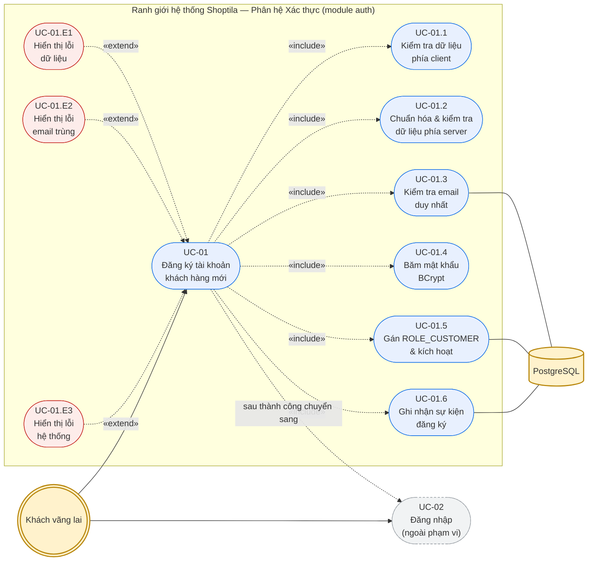
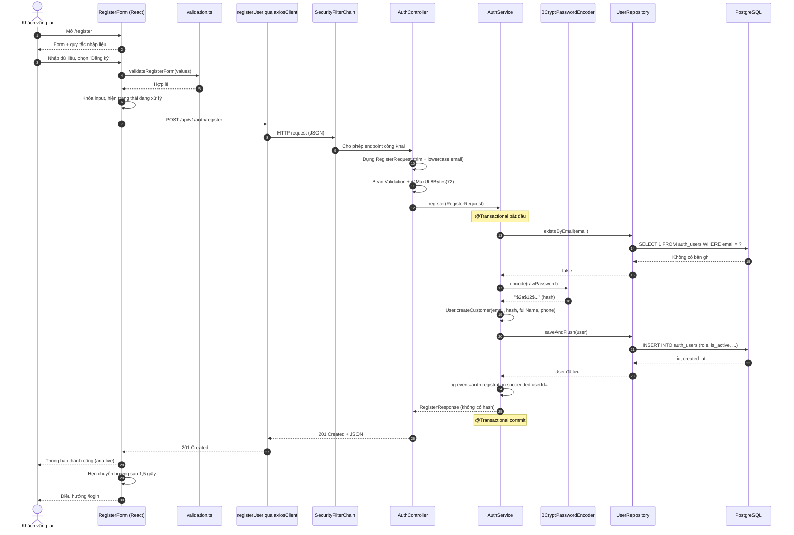
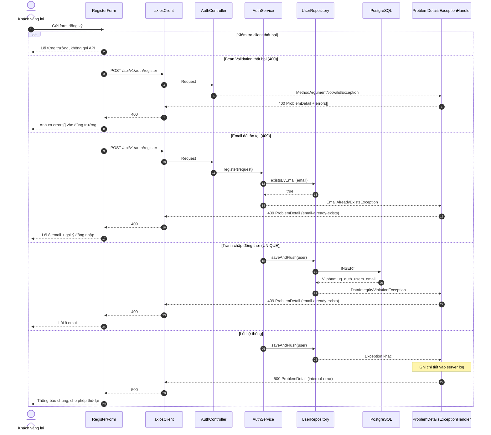
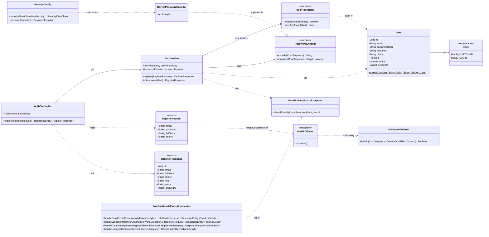
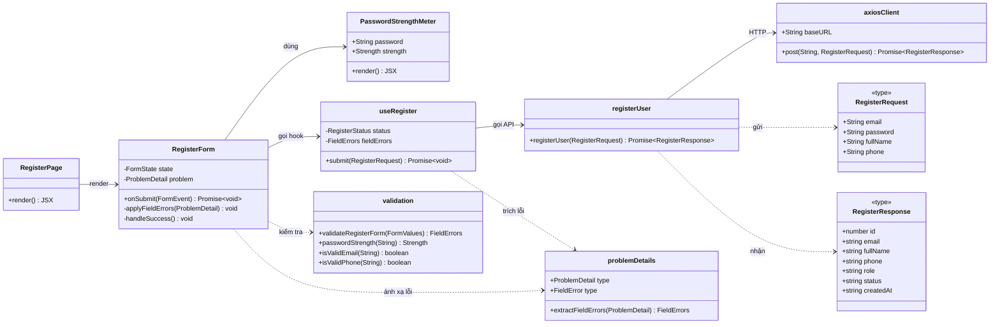

# Phân tích & Thiết kế UC-01 — Đăng ký tài khoản khách hàng mới

| Mục | Nội dung |
|:---|:---|
| **Use Case ID** | **UC-01** (tương ứng User Story **US-01**) |
| **Epic** | EPIC-01 — Quản lý định danh (Auth) |
| **Sprint** | Sprint 1 (Sprint 1.1) |
| **Phiên bản tài liệu** | 1.0 — Pha phân tích & thiết kế |
| **Ngày** | 2026-11-16 |
| **Tài liệu liên quan** | [spec.md](../../../specs/001-user-registration/spec.md) · [plan.md](../../../specs/001-user-registration/plan.md) · [research.md](../../../specs/001-user-registration/research.md) · [data-model.md](../../../specs/001-user-registration/data-model.md) · [OpenAPI contract](../../../specs/001-user-registration/contracts/auth-register.openapi.yaml) |

---

## Mục lục

1. [Tổng quan](#1-tổng-quan)
2. [Biểu đồ Use Case chi tiết](#2-biểu-đồ-use-case-chi-tiết)
3. [Đặc tả Use Case (Scenario)](#3-đặc-tả-use-case-scenario)
4. [Biểu đồ tuần tự (pha thiết kế)](#4-biểu-đồ-tuần-tự-pha-thiết-kế)
5. [Biểu đồ lớp (pha thiết kế)](#5-biểu-đồ-lớp-pha-thiết-kế)
6. [Truy vết yêu cầu](#6-truy-vết-yêu-cầu)
7. [Ghi chú & quyết định thiết kế](#7-ghi-chú--quyết-định-thiết-kế)

---

## 1. Tổng quan

### 1.1 Mục tiêu

Cho phép **khách vãng lai (Guest)** — người chưa có tài khoản và chưa đăng nhập — tự tạo tài khoản
khách hàng trên Shoptila bằng email, mật khẩu, họ tên và số điện thoại (tùy chọn). Sau khi đăng ký,
tài khoản ở trạng thái hoạt động và có quyền `ROLE_CUSTOMER`, sẵn sàng cho luồng đăng nhập (UC-02),
giỏ hàng và đặt hàng.

### 1.2 Phạm vi

**Trong phạm vi (Giai đoạn 1 — MVP):**

- Trang đăng ký `/register` và form nhập liệu có kiểm tra phía client.
- Endpoint công khai `POST /api/v1/auth/register`.
- Tạo bản ghi `auth_users` với email duy nhất, mật khẩu băm BCrypt, vai trò mặc định `ROLE_CUSTOMER`,
  trạng thái `ACTIVE`.
- Phản hồi thành công dạng DTO không chứa mật khẩu/hash; lỗi theo RFC 7807 `ProblemDetail`.
- Điều hướng sang `/login` sau khi thành công (không tự đăng nhập).

**Ngoài phạm vi:**

- Đăng nhập, cấp phát JWT (UC-02).
- Xác minh email/SMS, quên/đổi mật khẩu, cập nhật hồ sơ.
- Đăng ký bằng Google/Facebook (không có trong backlog Giai đoạn 1).
- Giới hạn tần suất/anti-bot (đã ghi nhận rủi ro, hoãn có kế hoạch).
- Cấp quyền `ROLE_ADMIN` qua bất kỳ API công khai nào.

### 1.3 Tác nhân

| Tác nhân | Loại | Vai trò trong UC-01 |
|:---|:---|:---|
| **Khách vãng lai (Guest)** | Chính | Người dùng chưa xác thực, thực hiện đăng ký |
| **Hệ thống CSDL PostgreSQL** | Phụ (hỗ trợ) | Lưu tài khoản, thực thi ràng buộc `UNIQUE`/`CHECK` |
| **Mật khẩu/BCrypt encoder** | Nội bộ | Thành phần kỹ thuật băm mật khẩu (không phải actor nghiệp vụ) |

### 1.4 Điều kiện & kết quả

| Loại | Nội dung |
|:---|:---|
| **Pre-condition** | 1. Khách chưa đăng nhập và sử dụng email chưa được đăng ký. 2. Thiết bị có kết nối Internet; backend và PostgreSQL đang hoạt động. 3. Migration `V1__init.sql` đã áp dụng, bảng `auth_users` tồn tại. 4. Giao diện đăng ký đã được tải thành công. |
| **Post-condition (thành công)** | 1. Một dòng `auth_users` mới được tạo với `role = ROLE_CUSTOMER`, `is_active = TRUE`, mật khẩu chỉ tồn tại dưới dạng băm BCrypt cost 12. 2. Sự kiện `auth.registration.succeeded` được ghi log (không chứa PII/mật khẩu). 3. Người dùng nhận thông báo thành công và được chuyển tới `/login`. |
| **Post-condition (thất bại)** | 1. Không có tài khoản mới hoặc bản ghi dở dang nào được tạo (rollback). 2. Tài khoản đã tồn tại (nếu có) không bị thay đổi. 3. Người dùng nhận thông báo lỗi tương ứng với nguyên nhân. |

---

## 2. Biểu đồ Use Case chi tiết

### 2.1 Biểu đồ

### 2.2 Phân rã Use Case

| ID | Tên | Quan hệ | Mô tả | Truy vết |
|:---|:---|:---:|:---|:---:|
| **UC-01** | Đăng ký tài khoản khách hàng mới | Base | Luồng nghiệp vụ chính, điều phối toàn bộ các bước | US-01 |
| UC-01.1 | Kiểm tra dữ liệu phía client | «include» | Chặn sớm email sai định dạng, mật khẩu yếu, xác nhận không khớp, SĐT sai, chưa đồng ý điều khoản | FR-005, FR-006, FR-012, FR-013 |
| UC-01.2 | Chuẩn hóa & kiểm tra dữ liệu phía server | «include» | Chuẩn hóa email/họ tên/SĐT, Bean Validation toàn bộ trường, kiểm tra 72 byte | FR-002, FR-005, FR-008, FR-012, FR-013 |
| UC-01.3 | Kiểm tra email duy nhất | «include» | Tra cứu theo email đã chuẩn hóa; CSDL bảo đảm `UNIQUE` khi tranh chấp | FR-003, FR-004, FR-015 |
| UC-01.4 | Băm mật khẩu BCrypt | «include» | Băm một chiều strength 12; không lưu/không trả mật khẩu rõ | FR-007 |
| UC-01.5 | Gán `ROLE_CUSTOMER` & kích hoạt | «include» | Gán quyền tối thiểu và `is_active = TRUE` do server quyết định | FR-009, FR-010, FR-015 |
| UC-01.6 | Ghi nhận sự kiện đăng ký | «include» | Log thành công/thất bại có cấu trúc, không PII | FR-016 |
| UC-01.E1 | Hiển thị lỗi dữ liệu | «extend» | Ánh xạ `400 errors[]` vào từng trường của form | FR-005, FR-014 |
| UC-01.E2 | Hiển thị lỗi email trùng | «extend» | Đánh dấu lỗi ô email, gợi ý đăng nhập/dùng email khác | FR-004, FR-014 |
| UC-01.E3 | Hiển thị lỗi hệ thống | «extend» | Thông báo chung, không lộ chi tiết nội bộ, cho phép thử lại | FR-014 |
| UC-02 | Đăng nhập | Liên kết ngoài | Tiếp nhận người dùng sau khi đăng ký thành công | US-02 |

**Ghi chú quan hệ:**

- `«include»`: UC-01 **luôn** thực hiện các bước con này trong luồng cơ bản.
- `«extend»`: UC-01.E* chỉ được kích hoạt khi xuất hiện điều kiện lỗi tương ứng tại một điểm mở rộng
  của UC-01.
- UC-02 không thuộc phạm vi UC-01; biểu đồ chỉ thể hiện bước chuyển tiếp sau thành công.

---

## 3. Đặc tả Use Case (Scenario)

| Trường | Nội dung |
|:---|:---|
| **Use Case ID** | **UC-01** (US-01) |
| **Use Case Name** | Đăng ký tài khoản khách hàng mới |
| **Description** | Là khách vãng lai, tôi muốn tạo tài khoản khách hàng trên Shoptila bằng email, mật khẩu, họ tên và số điện thoại để có thể đăng nhập, mua sắm và theo dõi đơn hàng. |
| **Actor(s)** | Khách vãng lai (Guest); Hệ thống CSDL PostgreSQL (phụ) |
| **Priority** | **Must Have** (3 SP) |
| **Trigger** | Khách vãng lai truy cập `/register` và chọn lệnh **Đăng ký tài khoản**. |
| **Pre-Condition(s)** | 1. Khách chưa đăng nhập và sử dụng email chưa từng được đăng ký. 2. Thiết bị có kết nối Internet; backend và PostgreSQL đang hoạt động. 3. Bảng `auth_users` đã tồn tại (Flyway `V1__init.sql` đã áp dụng). 4. Giao diện `/register` tải thành công. |
| **Post-Condition(s)** | **Thành công:** 1. Tài khoản mới ở trạng thái `ACTIVE`, quyền `ROLE_CUSTOMER`, mật khẩu chỉ lưu dạng băm BCrypt cost 12. 2. Log sự kiện `auth.registration.succeeded` (không có PII/mật khẩu). 3. Người dùng thấy thông báo thành công và được chuyển tới `/login`.  **Thất bại:** 1. Không tạo tài khoản/bản ghi dở dang; transaction rollback. 2. Người dùng nhận thông báo lỗi đúng nguyên nhân, dữ liệu đã nhập được giữ lại để sửa. |
| **Basic Flow** | 1. Khách vãng lai truy cập trang `/register`. 2. Hệ thống hiển thị form: Họ và tên, Email, Số điện thoại (tùy chọn), Mật khẩu, Xác nhận mật khẩu, ô đồng ý điều khoản. 3. Khách nhập dữ liệu và chọn **Đăng ký**. 4. Giao diện kiểm tra dữ liệu phía client (email, quy tắc mật khẩu, xác nhận mật khẩu, SĐT, điều khoản). Nếu không hợp lệ → **Exception 4a**. 5. Giao diện khóa input, hiển thị trạng thái đang xử lý và gửi `POST /api/v1/auth/register` với JSON `{email, password, fullName, phone?}`. Lỗi mạng → **Exception 5b**. 6. Backend dựng `RegisterRequest`: trim + lowercase email, trim họ tên/SĐT, SĐT rỗng → `null`; **không** biến đổi mật khẩu. 7. Bean Validation kiểm tra toàn bộ trường, gồm `@MaxUtf8Bytes(72)` cho mật khẩu. Vi phạm → **Exception 7a/7b**. 8. `AuthService` kiểm tra email đã tồn tại (`existsByEmail`). Đã tồn tại → **Exception 8a**. 9. `AuthService` băm mật khẩu bằng BCrypt strength 12. 10. Hệ thống tạo `User` với `role = ROLE_CUSTOMER`, `active = true`, `createdAt = now` và lưu (`saveAndFlush`). Vi phạm `UNIQUE` → **Exception 10a**; lỗi khác → **Exception 10b**. 11. Hệ thống ánh xạ `RegisterResponse` (không có mật khẩu/hash) và ghi log `auth.registration.succeeded` với `userId`. 12. Hệ thống trả `201 Created` kèm thông tin tài khoản. 13. Giao diện hiển thị thông báo thành công (`aria-live`) và hẹn chuyển hướng. 14. Sau khoảng 1,5 giây, giao diện điều hướng tới `/login`. Use Case kết thúc. |
| **Alternative Flow** | **2a. Khách đã có tài khoản:** 2a1. Khách chọn **Đăng nhập ngay**; 2a2. Hệ thống chuyển sang UC-02, UC-01 dừng. **3a. Không nhập số điện thoại:** 3a1. Trường SĐT để trống; 3a2. Hệ thống coi là `null`, tiếp tục bước 4. **3b. Khách xem mật khẩu/độ mạnh:** 3b1. Chọn hiện/ẩn mật khẩu hoặc quan sát thanh độ mạnh; 3b2. Giao diện cập nhật hiển thị, tiếp tục bước 4. **5a. Client gửi kèm thuộc tính lạ:** 5a1. Request chứa `role`, `isActive` hoặc `status`; 5a2. Backend bỏ qua thuộc tính không được khai báo, tiếp tục bước 6 với `ROLE_CUSTOMER`/`ACTIVE`. **13a. Khách không chờ chuyển hướng:** 13a1. Khách chọn **Đăng nhập ngay** trên thông báo thành công; 13a2. Hệ thống chuyển ngay sang UC-02, UC-01 kết thúc sớm. |
| **Exception Flow** | **4a. Kiểm tra phía client thất bại:** Giao diện hiển thị lỗi tại từng trường; không gửi request; Use Case dừng. **5b. Mất kết nối/timeout:** Giao diện thông báo chung, giữ dữ liệu đã nhập và cho phép thử lại; Use Case dừng. **7a. Bean Validation thất bại (400):** Trả `ProblemDetail` với `errors[]` liệt kê **tất cả** trường vi phạm; giao diện ánh xạ vào đúng trường; Use Case dừng. **7b. Mật khẩu vượt 72 byte UTF-8:** `@MaxUtf8Bytes(72)` báo lỗi trường `password` với HTTP `400`; **không** gọi BCrypt (tránh `IllegalArgumentException` → 500); Use Case dừng. **8a. Email đã tồn tại (409):** Trả `ProblemDetail` loại `email-already-exists`; giao diện đánh dấu lỗi ô email và gợi ý đăng nhập hoặc dùng email khác; Use Case dừng. **10a. Tranh chấp đồng thời cùng email:** Ràng buộc `uq_auth_users_email` cho đúng một giao dịch ghi thành công; giao dịch còn lại nhận `DataIntegrityViolationException` → `409` (không phải `5xx`); Use Case dừng với người dùng đó. **10b. Lỗi CSDL khác:** Transaction rollback; trả `500 internal-error` với thông điệp chung; chi tiết chỉ ghi server log; Use Case dừng. **12a. Gửi lặp do bấm đúp:** Nút bị vô hiệu hóa khi đang xử lý; nếu vẫn có request thứ hai, request đó nhận `409`; Use Case tiếp tục với kết quả của request đầu tiên. |
| **Business Rules** | **BR-01-1:** Email duy nhất toàn hệ thống, so sánh không phân biệt hoa/thường và sau khi trim — chuẩn hóa trong `RegisterRequest`, `UNIQUE (email)`, `CHECK (email = lower(email))`. **BR-01-2:** Đăng ký công khai chỉ gán `ROLE_CUSTOMER`; `ROLE_ADMIN` không bao giờ được gán qua API — DTO không có trường quyền, `User.createCustomer`, CHECK role ở CSDL. **BR-01-3:** Mật khẩu 8–72 ký tự, có ít nhất 1 chữ hoa, 1 chữ thường, 1 chữ số và không vượt quá 72 byte UTF-8; không trim, không cắt bớt — `@Size`, `@Pattern`, `@MaxUtf8Bytes(72)`. **BR-01-4:** Họ tên sau trim dài 2–100 ký tự; chấp nhận tiếng Việt có dấu — compact constructor + `@Size(min = 2, max = 100)`. **BR-01-5:** Số điện thoại tùy chọn; nếu có phải khớp `^(0\|\+84)[35789][0-9]{8}$` (không khoảng trắng, không dấu gạch) — `@Pattern` + chuẩn hóa chuỗi rỗng → `null`. **BR-01-6:** Tài khoản `ACTIVE` ngay sau đăng ký; không yêu cầu xác minh email/SMS ở Giai đoạn 1 — `is_active DEFAULT TRUE`. **BR-01-7:** Mật khẩu chỉ lưu dạng băm một chiều BCrypt cost 12; không trả về, không ghi log, không thể khôi phục — `BCryptPasswordEncoder(12)`, DTO không có hash. **BR-01-8:** Thành công trả `201`; dữ liệu sai trả `400`; email trùng trả `409`; lỗi hệ thống `500` không lộ nội bộ; mọi lỗi theo RFC 7807 `ProblemDetail` — `ProblemDetailsExceptionHandler`. **BR-01-9:** Không tự đăng nhập sau đăng ký; người dùng được chuyển sang `/login` — `RegisterForm` điều hướng sau 1,5 giây. **BR-01-10:** Ô đồng ý điều khoản do giao diện bắt buộc trước khi gửi; Giai đoạn 1 chưa lưu bằng chứng đồng ý — `validation.ts`. **BR-01-11:** Số điện thoại không bắt buộc duy nhất và không dùng để đăng nhập ở Giai đoạn 1 — không có ràng buộc `UNIQUE` trên cột `phone`. |
| **Non-Functional Requirement** | **NFR-01-1:** 95% yêu cầu đăng ký hợp lệ nhận phản hồi trong dưới 2 giây ở tải bình thường. **NFR-01-2:** BCrypt strength 12; điều chỉnh nếu p95 vượt NFR-01-1. **NFR-01-3:** Production dùng HTTPS; không lưu token trong `localStorage`. **NFR-01-4:** Log có cấu trúc (`event`, `userId`), không chứa email/mật khẩu/hash/token/payload thô. **NFR-01-5:** Giao diện responsive desktop/tablet/mobile; nhãn, `aria-invalid`, `aria-describedby`, `aria-live`; điều hướng bàn phím đầy đủ. **NFR-01-6:** Unit + integration (Testcontainers PostgreSQL) + concurrency; Vitest cho frontend; `npm run build` phải pass; trình duyệt không có lỗi console/5xx. **NFR-01-7:** Rate limiting chưa triển khai ở Giai đoạn 1 (rủi ro được chấp nhận và theo dõi). **NFR-01-8:** API stateless, CSRF tắt cho JSON API, giữ security headers mặc định của Spring Security. **NFR-01-9:** Swagger/OpenAPI đồng bộ với `contracts/auth-register.openapi.yaml`. |

---

## 4. Biểu đồ tuần tự (pha thiết kế)

### 4.1 Luồng cơ bản — đăng ký thành công

### 4.2 Các nhánh lỗi

### 4.3 Ghi chú thiết kế tuần tự

| Điểm | Thiết kế |
|:---|:---|
| **Ranh giới transaction** | `AuthService.register()` là `@Transactional`; `saveAndFlush` buộc lỗi ràng buộc xuất hiện ngay trong transaction để chuyển thành 409 thay vì lỗi commit khó xử lý. |
| **Kiểm tra trước + ràng buộc CSDL** | `existsByEmail` chỉ để phản hồi sớm/thân thiện; `UNIQUE` là cơ chế phân xử cuối cùng khi hai request đồng thời. |
| **Không băm khi chắc chắn lỗi** | Email trùng được phát hiện trước khi gọi BCrypt để tránh lãng phí CPU; lỗi validation (kể cả 72 byte) được chặn trước cả service. |
| **Xử lý lỗi tập trung** | Controller/Service không tự dựng body lỗi; mọi ánh xạ sang `ProblemDetail` nằm ở `ProblemDetailsExceptionHandler` (module `common`). |
| **Không trả entity** | Service trả `RegisterResponse`; entity `User` không đi ra khỏi tầng web. |
| **Mật khẩu một chiều** | Chỉ `encode()` được gọi; log/handler không có đường nào chạm tới mật khẩu thô. |
| **Bất biến tạo tài khoản** | Hoặc một dòng hoàn chỉnh, hoặc rollback; không có tài khoản dở dang. |

---

## 5. Biểu đồ lớp (pha thiết kế)

### 5.1 Backend — module `auth` và hạ tầng `common`

**Ghi chú lớp backend:**

- `RegisterRequest` là record với compact constructor chuẩn hóa `email` (trim + lowercase),
  `fullName`/`phone` (trim), và chuyển SĐT rỗng thành `null` **trước** Bean Validation.
  Record **không** có `role`, `isActive`, `status` — mọi thuộc tính lạ từ JSON bị bỏ qua.
- `User.createCustomer(...)` là factory duy nhất dùng cho đăng ký; nó đặt `role = ROLE_CUSTOMER` và
  `active = true`, nên không có đường tạo tài khoản admin ngoài ý muốn.
- `User` không có getter trả mật khẩu; `toString()` không chứa `passwordHash`.
- `PasswordEncoder` là abstraction của Spring Security; `BCryptPasswordEncoder(12)` được tạo như
  bean trong `SecurityConfig` (module `common`), `AuthService` chỉ phụ thuộc interface.
- `ProblemDetailsExceptionHandler` nằm ở `common`, không import lớp nào của `auth`; nó xử lý
  `EmailAlreadyExistsException` cũng thuộc `common`. Vì vậy `common` không phụ thuộc nghiệp vụ.
- Không có quan hệ JPA chéo module; `Role` là enum, không phải entity/bảng riêng (quyết định R-01).

### 5.2 Frontend — `features/auth` và `shared`

**Ghi chú lớp frontend:**

- `validation.ts` chứa hàm thuần (pure), không phụ thuộc React → kiểm thử trực tiếp bằng Vitest.
  Quy tắc phản chiếu backend (email, độ mạnh, 2–100 ký tự, SĐT VN, 72 byte qua `TextEncoder`).
- `useRegister` giữ trạng thái `idle/loading/success/error`; input bị khóa khi `loading` để chống
  double-submit.
- `problemDetails.ts` là **cổng duy nhất** đọc `ProblemDetail`: trích `errors[]` thành map
  `field → message`; 409 được gán vào trường `email` bằng `detail`.
- `axiosClient` là cổng HTTP duy nhất (baseURL `/api/v1`); chỗ nối JWT cho header sẽ được thêm ở
  UC-02, không lưu token trong `localStorage`.
- `RegisterPage` chỉ điều phối; không chứa logic HTTP hay validation.
- Toàn bộ chuỗi hiển thị bằng tiếng Việt và có nhãn `aria` cho trình đọc màn hình.

---

## 6. Truy vết yêu cầu

| Bước UC-01 | Yêu cầu chức năng | Thành phần thiết kế |
|:---:|:---|:---|
| 2, 3 | FR-001 | `RegisterPage`, `RegisterForm` |
| 4 | FR-005, FR-006, FR-012, FR-013 | `validation.ts`, `PasswordStrengthMeter` |
| 5 | FR-001, FR-014 | `registerUser`, `axiosClient` |
| 6 | FR-002, FR-012 | Compact constructor `RegisterRequest` |
| 7 | FR-005, FR-008, FR-014 | Bean Validation, `@MaxUtf8Bytes`, `ProblemDetailsExceptionHandler` |
| 8 | FR-003, FR-004, FR-015 | `UserRepository.existsByEmail`, `UNIQUE (email)` |
| 9 | FR-007, FR-008 | `BCryptPasswordEncoder(12)` |
| 10 | FR-009, FR-010, FR-015 | `User.createCustomer`, `Role`, `is_active` |
| 11 | FR-011, FR-016 | `RegisterResponse`, log sự kiện |
| 12 | FR-011, FR-014 | `AuthController`, `ProblemDetail` |
| 13, 14 | FR-017 | `RegisterForm` thông báo + điều hướng `/login` |
| 5a | FR-009 (chống tự gán quyền) | DTO không có trường `role`/`isActive` |

**Truy vết ngược:** mỗi FR-001…FR-017 của [spec.md](../../../specs/001-user-registration/spec.md)
đều có ít nhất một bước, thành phần hoặc ràng buộc CSDL tương ứng trong tài liệu này.

---

## 7. Ghi chú & quyết định thiết kế

| Quyết định | Nội dung | Tham chiếu |
|:---|:---|:---|
| Mô hình vai trò | Một cột `role` + enum Java; nâng cấp nhiều vai trò bằng migration sau | R-01 |
| Duy nhất email | Chuẩn hóa trim + lowercase; `UNIQUE` + `CHECK (email = lower(email))`; xử lý `DataIntegrityViolationException` | R-02 |
| Băm mật khẩu | BCrypt strength 12; chặn > 72 byte UTF-8 trước khi băm (CVE-2025-22228) | R-03 |
| Hợp đồng lỗi | RFC 7807 `ProblemDetail` + `errors[]` cho lỗi trường; 500 không lộ nội bộ | R-04 |
| Bảo mật filter chain | Stateless, CSRF tắt, fail-closed, permit `/error` và dispatch `ERROR` | R-05 |
| Chuẩn hóa đầu vào | Compact constructor record; DTO không có trường quyền/trạng thái | R-06 |
| Hợp đồng HTTP | `POST /api/v1/auth/register`; 201/400/409; `Instant` ISO-8601 UTC | R-07 |
| Phiên bản | Spring Boot 3.5.16, springdoc 2.8.16, React 19.3.1, Vite 8.3.8, TypeScript 5.9.3 | R-08 |
| Kiểm thử | Unit + Testcontainers integration + concurrency + Vitest | R-09 |
| Observability | Log có cấu trúc, không PII/mật khẩu/token | R-10 |

**Rủi ro đã biết:** chưa có rate limiting/anti-bot trên endpoint đăng ký (NFR-01-7) và chưa xác
minh email ở Giai đoạn 1 (BR-01-6). Cả hai đã được ghi nhận trong [plan.md](../../../specs/001-user-registration/plan.md);
không cấp giao dịch tiền hay quyền quản trị cho tài khoản chưa xác minh trong giai đoạn này.
